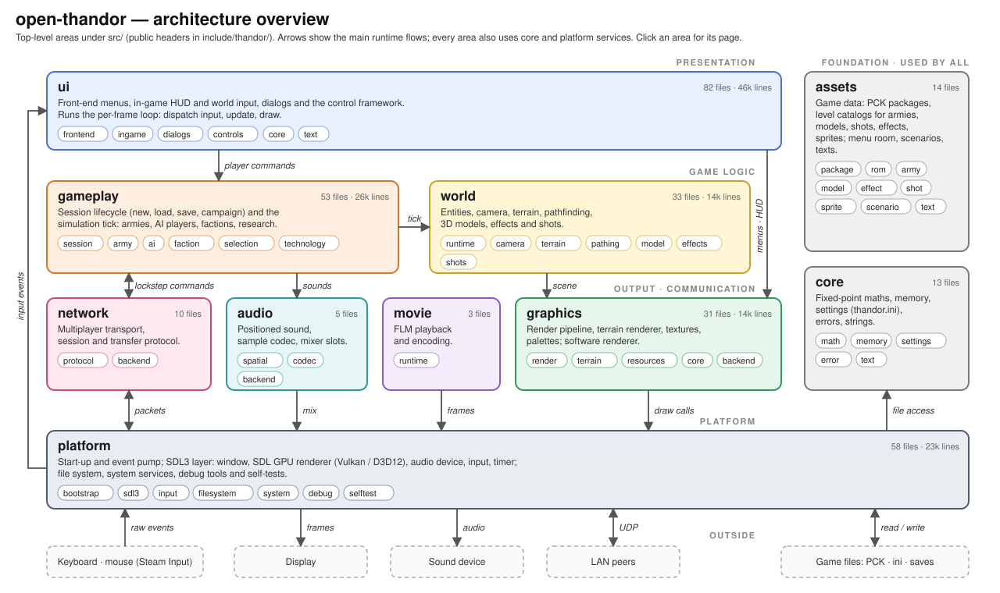

# Architecture

Block diagrams of how open-thandor is put together, starting with the whole game and going down one level per area. For a file-by-file listing see the [module tree](../MODULE_TREE.md) and the [source file guide](../SOURCE_FILE_GUIDE.md).

The boxes are clickable when you open [overview.svg](overview.svg) on its own. In this page, use the table below.

## Areas

| Layer | Area | What it does |
| --- | --- | --- |
| Presentation | [ui](ui/README.md) | Front-end menus, in-game HUD and world input, dialogs, control framework; runs the per-frame loop |
| Game logic | [gameplay](gameplay/README.md) | Session lifecycle (new, load, save, campaign) and the simulation tick: armies, AI, factions, research |
| Game logic | [world](world/README.md) | Entities, camera, terrain, pathfinding, 3D models, effects and shots |
| Output | [graphics](graphics/README.md) | Render pipeline, terrain renderer, textures, palettes, software renderer |
| Output | [audio](audio/README.md) | Positioned sound, sample codec, mixer slots |
| Output | [movie](movie/README.md) | FLM movie playback and encoding |
| Communication | [network](network/README.md) | Multiplayer transport and the session and transfer protocol |
| Foundation | [assets](assets/README.md) | PCK packages, the per-level catalogs for armies, models, shots, effects and sprites, the menu room, scenarios and texts |
| Foundation | [core](core/README.md) | Fixed-point maths, memory, settings (`thandor.ini`), errors, strings |
| Platform | [platform](platform/README.md) | Start-up and event pump, SDL3 layer (window, SDL GPU renderer, audio device, input, timer), file system, system services, debug tools, self-tests |

## Main flows

- **Input:** keyboard and mouse (on the Steam Deck, Steam Input emulates both; the game has no gamepad code) → `platform` (SDL3 events, key mask, pointer ring) → `ui` (dispatch to the active page, pointer capture) → player commands into `gameplay`.
- **Simulation:** `gameplay` runs the tick, advances `world` (entities, pathing, effects, shots) and in multiplayer exchanges the commands in lockstep through `network`.
- **Frame:** `world` provides the scene and `ui` the menus and HUD; `graphics` turns both into draw calls that `platform` sends to the SDL GPU renderer (or the software renderer) and the display.
- **Sound and movies:** `gameplay` and `ui` trigger sounds that `audio` positions and mixes; `movie` plays FLM files; both output through `platform`.
- **Data:** `assets` reads PCK packages and tables through the `platform` file system; `core` holds the settings from `thandor.ini`.

The arrows describe the main runtime flows, not every include: nearly every source file includes the umbrella header `thandor/thandor.h`, so include edges say little about who calls whom.

## Updating the diagrams

Each diagram is drawn by a script in [`tools/docs/architecture`](../../tools/docs/architecture). Run it from the repository root, for example `python tools/docs/architecture/gen_overview.py`. The scripts share [`archsvg.py`](../../tools/docs/architecture/archsvg.py) for colours and box and arrow style.
