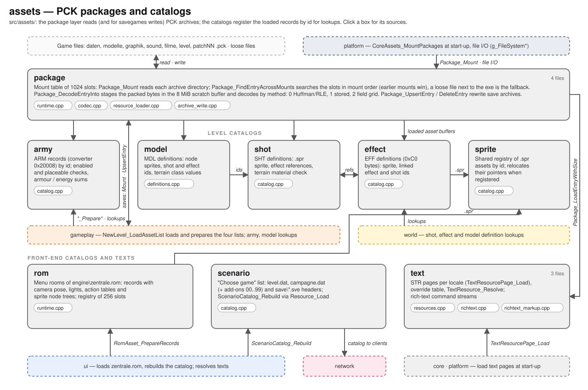

# assets

[Architecture overview](../README.md)

The assets area reads the game data. The `package` module mounts the PCK archives, finds entries in them and decodes them. It also writes entries, which is how savegames are stored. The catalog modules take a loaded file, check its header and record sizes, and register its records by id so other areas can look them up: armies, models, shots, effects and sprites for a level, then the menu rooms (ROM), the "Choose game" scenario list and the localized text pages.

The boxes are clickable when you open [assets.svg](assets.svg) on its own. In this page, use the table below.

## Modules

| Module | Responsibility | Key files | Public headers |
| --- | --- | --- | --- |
| package | Mount table, entry lookup across mounts, loading into arena buffers, PCK codecs (Huffman/RLE, stored, field grid), writing and deleting entries in save archives | [runtime.cpp](../../../src/assets/package/runtime.cpp), [codec.cpp](../../../src/assets/package/codec.cpp), [resource_loader.cpp](../../../src/assets/package/resource_loader.cpp), [archive_write.cpp](../../../src/assets/package/archive_write.cpp) | `assets/package.h`, `package/runtime.h`, `package/codec.h`, `package/resource_loader.h`, `package/archive_write.h`, `package/types.h` |
| army | Registry of ARM records (units, objects): enabled, placeable and missing-id checks, armour and energy sums over the model tree | [catalog.cpp](../../../src/assets/army/catalog.cpp) | `assets/army.h`, `army/catalog.h`, `army/types.h` |
| model | Registry of MDL definitions: loads the sprites of the node tree, resolves shot and effect ids, copies terrain class values, packed-point lookup table | [definitions.cpp](../../../src/assets/model/definitions.cpp) | `assets/model.h`, `model/definitions.h`, `model/types.h` |
| shot | Registry of SHT definitions: loads each shot's sprite, resolves its effect references, checks terrain material references | [catalog.cpp](../../../src/assets/shot/catalog.cpp) | `assets/shot.h`, `shot/catalog.h`, `shot/types.h` |
| effect | Registry of EFF definitions (0xC0-byte records): loads each effect's sprite, later resolves linked effect and shot ids into pointers | [catalog.cpp](../../../src/assets/effect/catalog.cpp) | `assets/effect.h`, `effect/catalog.h`, `effect/types.h` |
| sprite | Shared registry of `.spr` sprite assets by id; relocates a sprite's internal offsets into pointers when it is registered, and back for saving | [catalog.cpp](../../../src/assets/sprite/catalog.cpp) | `assets/sprite.h`, `sprite/catalog.h`, `sprite/types.h` |
| rom | Front-end menu rooms from `engine\zentrale.rom`: records with camera pose, lights, action tables (camera flights) and sprite node trees; 256 registry slots | [runtime.cpp](../../../src/assets/rom/runtime.cpp) | `assets/rom.h`, `rom/runtime.h`, `rom/types.h` |
| scenario | `g_ScenarioCatalog`, the list behind the "Choose game" tabs: single missions, campaigns and savegame headers | [catalog.cpp](../../../src/assets/scenario/catalog.cpp) | `assets/scenario.h`, `scenario/catalog.h`, `scenario/types.h` |
| text | Localized STR text pages, runtime override table, text lookup by id; rich-text command streams; TXT2STR markup parser | [resources.cpp](../../../src/assets/text/resources.cpp), [richtext.cpp](../../../src/assets/text/richtext.cpp), [richtext_markup.cpp](../../../src/assets/text/richtext_markup.cpp) | `assets/text.h`, `text/resources.h`, `text/richtext.h`, `text/richtext_markup.h`, `text/types.h` |

`include/thandor/assets/record_bytes.h` holds the `Asset_RecordAt` / `Asset_RecordAfter` helpers that every catalog uses to walk variable-size records by byte offset.

## Main flows

### Mounting the packages and loading a resource

1. At start-up `CoreAssets_MountPackages` (platform bootstrap) calls `Package_Mount` for `patchNN.pck` and `levelNN.pck` (NN counting down), then `daten.pck`, `modelle.pck`, `graphik.pck`, `sound.pck`, `filme.pck` and `level.pck`. The platform file system adds `engine.pck` through `Package_MountLowPriority`. Gameplay mounts a level package or a savegame archive with `Package_Mount` as needed.
2. `Package_Mount` opens the archive (next to the executable first, then as given), takes the first free slot of the 1024-slot mount table and reads its directory (`Package_ReadDirectory`).
3. A load goes through `Package_LoadEntry`, `Package_LoadEntryWithSize` or the thin wrapper `Resource_Load`. `Package_FindEntryAcrossMounts` scans the slots in mount order, so earlier mounts win and patches override the base packages. If no package has the path, `FileSystem_LoadWholeFileNearExecutable` loads a loose file instead.
4. For a package entry, the buffer is allocated with `g_MemoryApi.alloc` (core arena). `Package_DecodeEntryInto` seeks to the entry, reads the packed bytes into `g_PackageScratchBuffer` (8 MiB) and calls `g_PckDecoderTable[method]`: 0 `PckCodec_DecodeHuffmanRle`, 1 `PckCodec_DecodeStored`, 2 the field-grid decoder (`PckCodec_DecodeFieldGrid`, see [field_grid_format.md](../../field_grid_format.md)). An unknown method or an oversized stored entry is rejected.
5. On failure `Package_SetLastErrorPath` records the path for the fatal-error message (see [core](../core/README.md)). `Resource_Release` frees the buffer back to the arena.

Savegames go the other way: `Package_UpsertEntry` (called from gameplay `savegame.cpp` and `campaign_carryover.cpp`) encodes through `g_PckEncoderTable` and writes the entry into the mounted archive. `Package_MakeTemporaryPath`, `Package_CommitTemporary` and `Package_DiscardTemporary` handle the temporary file.

### Building the level catalogs

The level file (see [level_format.md](../../level_format.md)) lists the EFF, SHT, MDL and ARM files a level needs. Gameplay `NewLevel_LoadAssetList` (`src/gameplay/session/level_new.cpp`) loads each file with `Package_LoadEntryWithSize` and hands it to a prepare function:

- `EffectAsset_PrepareEntries` checks the `eff` magic and converter version, then `EffectDefinition_RegisterAndLoadSprite` registers each definition and loads its sprite.
- `ShotAsset_PrepareEntries` → `ShotDefinition_RegisterAndResolveReferences` loads the shot sprite and resolves effect references through `EffectDefinitionRegistry_FindById`.
- `ModelAsset_PrepareRecords` walks the MDL records within the asset size, loads the node sprites (`ModelDefinition_ResolveNodeSprites`), resolves shot and effect ids (`ModelDefinition_ResolveShotAndEffectIds`) and copies terrain class values.
- `ArmyAsset_PrepareRecords` checks magic and converter version 0x20008 and registers each record with `ArmyAssetRecord_RegisterAndRelocate`.

Every sprite load goes through `SpriteAsset_RegisterAndRelocatePointers`, after `SpriteAssetRegistry_FindById` has checked for an already registered id. After all lists are loaded, `EffectDefinitions_ResolveCrossReferences` replaces the linked effect and shot ids in the effect definitions with pointers. `ShotDefinitions_ValidateTerrainMaterialReferences` runs after the terrain is loaded. Both are also called when a savegame is loaded (`level_saved.cpp`). All prepare steps check record sizes against the asset size and fail with a `FATAL_ERROR_*_ASSET_INVALID` code and a fixed error name.

### Front-end catalogs and texts

- **ROM:** ui `src/ui/frontend/lifecycle.cpp` loads `engine\zentrale.rom` and calls `RomAsset_PrepareRecords`. That validates each record (action table, light count, keyframes 2..9), and `RomAssetRecord_RegisterAndRelocate` puts it into `g_RomRegistrySlots` and loads its node sprites. The front end looks records up with `RomRegistry_FindRecordById` and `RomRecordTable_FindRecordById`, and frees them with `FrontendRomRegistry_ClearAndReleaseNestedResources`.
- **Scenarios:** ui `main_loop.cpp` calls `ScenarioCatalog_Rebuild`. It loads `level\level.dat` and `level\campagne.dat` with `Resource_Load`, merges the add-ons `level00..99.dat` and `campagne00..99.dat` by name, and appends the header record of every `save\*.sve`. A network host sends this catalog to its clients.
- **Texts:** `TextResourcePage_Load` loads an STR file as one page and picks the locale block of `g_LocaleCountryCodeOverride` (from the core settings), else the British block, else the first one. Page 0 (`texte\error.str`) comes from core `ErrorSystem_Init`, the other pages from platform bootstrap and ui `window.cpp`. `TextResource_TryResolve` / `TextResource_Resolve` look up an id: first the override table (`TextResourceOverride_Register`, used for level titles by `TextResourcePage_LoadCompatibilityAliases`), then the page. The strings are rich-text command streams, processed by the `RichTextCommandStream_*` functions in `richtext.cpp`.

### Who uses which catalog

From the call sites outside `src/assets/` (grep for the lookup functions):

| Catalog | Used by |
| --- | --- |
| army (`ArmyAssetRegistry_*`) | gameplay, ui |
| model (`ModelDefinitionRegistry_*`) | gameplay, world |
| effect (`EffectDefinitionRegistry_*`) | gameplay, ui, world |
| shot (`ShotDefinitionRegistry_*`) | world |
| sprite (`SpriteAssetRegistry_*`) | gameplay (reset at session start, savegame load), ui |
| rom (`RomRegistry_*`, `RomRecordTable_*`) | ui (front end) |
| scenario (`g_ScenarioCatalog`, `ScenarioCatalog_*`) | ui, network, gameplay, platform (debug tools) |
| text (`TextResource_*`, `RichTextCommandStream_*`) | ui (most), network, gameplay, platform, core |

## Interfaces to other areas

- [platform](../platform/README.md): mounts the packages at start-up (`CoreAssets_MountPackages`, `Package_MountLowPriority`) and provides the file I/O the package layer calls (`g_FileSystemOpen`, `g_FileSystemSeek`, `g_FileSystemReadExact`, `g_FileSystemWriteExactOrFlush`, `FileSystem_LoadWholeFileNearExecutable`). It also loads text pages, and its self-tests exercise the field-grid codec.
- [core](../core/README.md): all buffers come from the arena (`g_MemoryApi`), and path edits use `WidePath_SetExtensionCode`. The fatal-error path shows `g_PackageLastErrorPath` and the error texts of page 0. The locale choice reads `g_LocaleCountryCodeOverride`.
- [gameplay](../gameplay/README.md): builds the level catalogs (`NewLevel_LoadAssetList`), mounts level and save packages, writes savegames with `Package_UpsertEntry`, and encodes the field grid (`PckCodec_EncodeFieldGrid` in `scenario_load.cpp`).
- [world](../world/README.md): looks up shot, effect and model definitions at run time.
- [ui](../ui/README.md): loads the ROM menu rooms, rebuilds the scenario catalog, resolves almost every visible text, and uses army, effect and sprite lookups.
- [network](../network/README.md): sends the scenario catalog to clients and decodes transferred field grids (`PckCodec_DecodeFieldGrid` in `scenario_transfer.cpp`).
- [graphics](../graphics/README.md): `RichTextCommandStream_BindTextureSource` takes a `GraphicsTextureSourceAsset`. The rendering of sprites and texts lives in graphics and ui. (Direct graphics calls into the catalogs not checked in detail.)

## Notes

- Every prepare and decode step bounds what the original trusted: record sizes, path lengths inside assets, compression method and stored size. The comments next to each check describe the original behaviour.
- `RichTextMarkup_ParseAndBuildStringAsset` (TXT2STR markup to STR asset) has no caller in `src/`.
- The ROM format here is the front-end menu-room asset. The level catalogs do not come from ROM tables: they come from the per-level EFF/SHT/MDL/ARM files.
