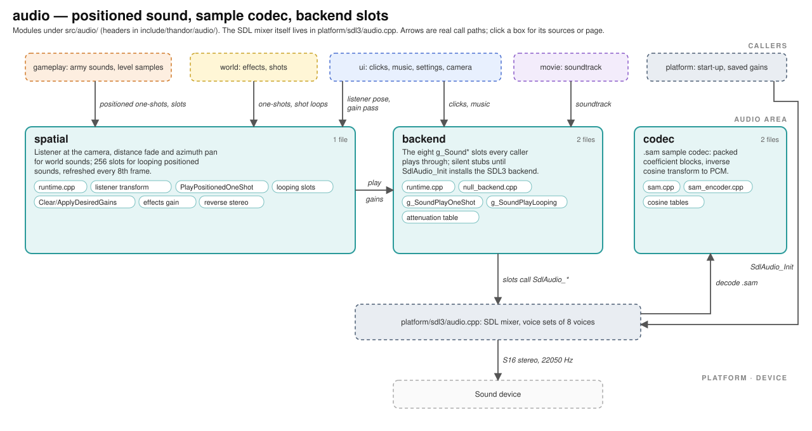

# audio

[Architecture overview](../README.md)

The audio area turns sound requests from the game into calls on eight backend function slots. `spatial` places world sounds relative to a listener at the camera (distance fade and stereo pan), `backend` holds the slots and the silent stubs they start with, and `codec` decodes the game's `.sam` sample format. The real mixer and the SDL audio device live in the platform layer ([`src/platform/sdl3/audio.cpp`](../../../src/platform/sdl3/audio.cpp)), which installs itself into the slots at start-up.

The boxes are clickable when you open [audio.svg](audio.svg) on its own. In this page, use the table below.

## Modules

| Module | Responsibility | Key files | Public headers |
| --- | --- | --- | --- |
| `audio/spatial` | Listener transform from the camera pose; distance attenuation and azimuth panning for positioned one-shots; pool of 256 slots for looping positioned sounds with a clear / apply pass per refresh; global effects gain and reverse-stereo switch | [`runtime.cpp`](../../../src/audio/spatial/runtime.cpp) | [`spatial.h`](../../../include/thandor/audio/spatial.h), [`spatial/runtime.h`](../../../include/thandor/audio/spatial/runtime.h), [`spatial/types.h`](../../../include/thandor/audio/spatial/types.h) |
| `audio/backend` | The eight `g_Sound*` function slots (create / release voice set, play one-shot, play looping, stop, is-finished, set gains, stop all), initialised to the silent `SoundBackendDisabled_*` stubs; the DirectSound attenuation table `g_SoundGainAttenuation` the SDL mixer uses as gain curve | [`runtime.cpp`](../../../src/audio/backend/runtime.cpp), [`null_backend.cpp`](../../../src/audio/backend/null_backend.cpp) | [`backend.h`](../../../include/thandor/audio/backend.h), [`backend/runtime.h`](../../../include/thandor/audio/backend/runtime.h), [`backend/null_backend.h`](../../../include/thandor/audio/backend/null_backend.h), [`backend/types.h`](../../../include/thandor/audio/backend/types.h) |
| `audio/codec` | `.sam` codec: unpacks a coded block into 256 coefficients (`SoundSample_DecodePackedCoefficientBlock`), inverse cosine transform to 256 stereo PCM frames (`SoundSample_DecodeCoefficientBlockToPcmMmx`), cosine tables (`CosineDerivedLookupTables_Init`); the encoder side is used only by the self-tests | [`sam.cpp`](../../../src/audio/codec/sam.cpp), [`sam_encoder.cpp`](../../../src/audio/codec/sam_encoder.cpp) | [`codec.h`](../../../include/thandor/audio/codec.h), [`codec/sam.h`](../../../include/thandor/audio/codec/sam.h), [`codec/sam_encoder.h`](../../../include/thandor/audio/codec/sam_encoder.h), [`codec/types.h`](../../../include/thandor/audio/codec/types.h) |

## Main flows

**Start-up.** `ProcessEntry_RunGame` (platform bootstrap) calls `SdlAudio_Init`: it opens one SDL playback stream (16-bit stereo, 22050 Hz) with `MixCallback`, allocates the 256-entry voice-set registry, builds the codec tables with `CosineDerivedLookupTables_Init` and then points every `g_Sound*` slot at its `SdlAudio_*` function. Without a device, or without memory for the tables, the slots keep the silent stubs and the game runs without sound. `GameRuntime_InitializeSpatialAudioAndRendering` allocates the spatial slot pool (`SpatialSoundPool_Init`). `SdlAudio_Shutdown` (from `Runtime_Shutdown`) puts the silent stubs back.

**Loading a sample.** Callers load a `.sam` file with `Resource_Load` (assets) and pass it to `g_SoundCreateSampleVoiceSet`, which is `SdlAudio_CreateSampleVoiceSet`: it checks the header against the byte count, decodes every block through the codec into one PCM buffer and returns a voice set (up to eight voices playing that sample). Level sounds that loop at a position go through `SpatialSoundSlot_CreateFromSampleAsset` instead, which creates the voice set and takes a free spatial slot (`NewLevel_PrepareArmyAsset` and the saved-level path in `gameplay/session`).

**A world sound reaching the device.**
1. One-shots: army, factory, walker and effect code (for example `ModelRuntime_PlayDefinitionOneShotSound`, `EffectRuntime_RebaseSlotsAfterLoad` in `world/effects`) calls `SpatialSound_PlayPositionedOneShot` with the world position, maximum distance and gain.
2. Looping sounds: every 8th presentation tick `InGameUiRoot_UpdateEffectSounds` (`ui/ingame/root_frame.cpp`) calls `SpatialSoundPool_ClearDesiredGains`, runs the audio-refresh callback of every world object (`g_RuntimeMaintenanceCallbackPhases.audioRefresh`: for armies `ArmyRuntimeMaintenance_DispatchClassMethodDRecursive`, which reaches `ArmyRuntime_UpdateLoopingPositionedSound`; for shots `ShotRuntimeMaintenance_UpdateHierarchyProjectedSound`), which call `SpatialSound_UpdateDesiredPositionedGains`, then `SpatialSoundPool_ApplyDesiredGains` starts, stops or re-gains each slot's voice through `g_SoundPlayLooping`, `g_SoundStopVoice` and `g_SoundSetVoiceGains`.
3. Both paths use `SpatialSound_ComputePositionedGains`: the position goes into listener space with the transform that `SpatialSound_RebuildListenerTransformFromPose` builds from the camera (called by the world view render in `ui/frontend/menu_room.cpp` for views flagged `WORLD_RUNTIME_FLAG_SOUND_LISTENER`, frontend and in-game). The gain fades with a quarter cosine over the distance, is panned by azimuth, swapped when `g_ReverseStereoMask` is set and clamped to Q15 full scale; nothing plays at or below `SPATIAL_SOUND_MIN_AUDIBLE_GAIN_Q15`.
4. The SDL backend turns the two Q15 channel gains into DirectSound-style volume and pan via `g_SoundGainAttenuation` (`ApplyChannelGains`), and `MixCallback` mixes every playing voice into the stream under the mixer mutex.

**Unpositioned sounds and music.** UI controls play click sounds straight through `g_SoundPlayOneShot` at `g_UiSoundGainQ15` (buttons, lists, sliders, text edits, in-game command buttons and hotkeys). Menu music: `FrontendMusic_StartMenuMusic` loads `sound\music00.sam` and plays it with `g_SoundPlayLooping`. In-game, `NewLevel_LoadLevelSamples` loads four ambient effect and four music samples of the level; `InGameUiRoot_UpdateEffectSounds` plays a random ambient sample after a random delay, and `InGameUiRoot_UpdateMusic` waits for the current track to end (`g_SoundIsVoiceFinished`), then plays the level track with the best `InGameMusic_ComputeTrackSuitabilityScore` as a one-shot. Movie soundtracks use the same slots (see [movie](../movie/README.md)).

**Volume settings.** `CoreAssets_ApplySoundSettings` (platform bootstrap) reads the saved options: `g_UiSoundGainQ15` and `g_SoundEffectsGainQ15` (0 when effects are off), the movie gains and `g_ReverseStereoMask`. The settings pages change them live: `FrontendAudioSettings_*` and `InGameAudioSettings_*` (`SetEffectsGain`, `SetMusicGain`, `SetReverseStereo`, `SetMusicEnabled`, `SetEffectsEnabled`) write the globals and call `g_SoundSetVoiceGains` or `g_SoundStopVoice` on the running music or ambient voice. `g_SoundEffectsGainQ15` scales every positioned sound in `spatial`.

## Interfaces to other areas

- [gameplay](../gameplay/README.md): army sound code (`gameplay/army/audio.cpp`, `aircraft.cpp`, `walker.cpp`, ...) plays positioned sounds; `gameplay/session` loads and releases level samples and slots (`NewLevel_LoadLevelSamples`, `InGameLevelRuntime_ShutdownLoadedAssetResources`) and stops all voices on session changes (`g_SoundStopAllVoices` in `startup.cpp`).
- [world](../world/README.md): effects play positioned one-shots, shots keep looping slots up to date; the world runtime keeps the slot pointers in its workspace array.
- [ui](../ui/README.md): control click sounds, menu and in-game music, ambient sounds, the spatial refresh pass, the listener pose and the audio settings pages.
- [movie](../movie/README.md): `Movie_Open` turns one embedded soundtrack into a voice set; `Movie_AdvanceFrame` starts it with the first frame.
- [platform](../platform/README.md): SDL3 mixer and device (`src/platform/sdl3/audio.cpp`), start-up and shutdown, saved gains; the self-tests exercise the codec round trip.
- [assets](../assets/README.md): `Resource_Load` reads the `.sam` files from packages or disk.
- [core](../core/README.md): arena allocator (`g_MemoryApi`) for voice sets, registry and slot pool; fixed-point transforms and the sine table for the gain maths; persistent settings for the gains.

## Notes

- The original used DirectSound; open-thandor keeps its arena layout (`SoundVoiceSet` blocks, the 256-entry registry) and its attenuation curve, so gains sound as before. A voice that played to its end restarts from the beginning, a stopped voice resumes where it stopped, as with DirectSound buffers.
- `SdlAudio_CreateSampleVoiceSet` bounds the decode by the asset size; the original trusted the header and could read past a short or forged asset.
- `SpatialSoundSlot` names its gains after the channel they play on; the original stored them crosswise and swapped them back when playing (see the comment in `spatial/types.h`).
