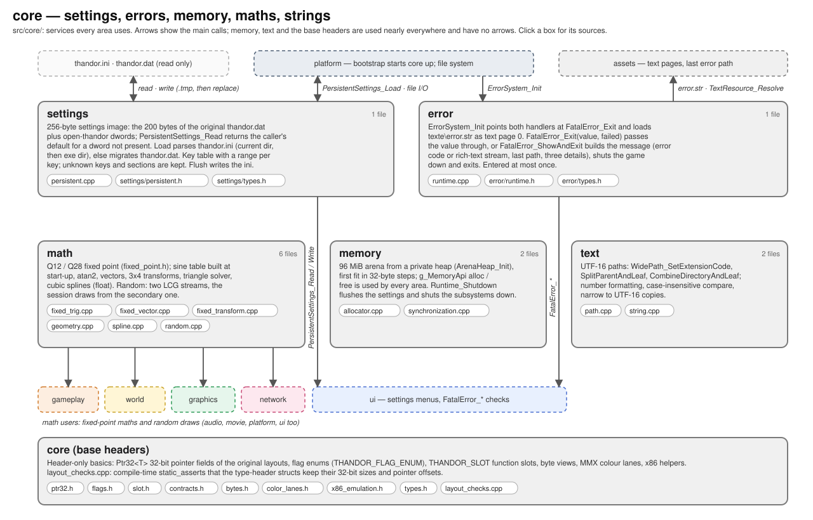

# core

[Architecture overview](../README.md)

The core area holds the services every other area builds on: the persistent settings (`thandor.ini`), the fatal-error path, the memory arena, fixed-point maths with the two random streams, and UTF-16 path and string helpers. A set of header-only basics (32-bit pointer fields, flag enums, function slots) and the compile-time layout checks also live here. Core has no game logic. Platform bootstrap starts it up, and every area calls into it.

The boxes are clickable when you open [core.svg](core.svg) on its own. In this page, use the table below.

## Modules

| Module | Responsibility | Key files | Public headers |
| --- | --- | --- | --- |
| settings | Settings image (256 bytes), `thandor.ini` parse and format with key table and value ranges, `thandor.dat` migration, typed option accessors | [persistent.cpp](../../../src/core/settings/persistent.cpp) | `core/settings.h`, `settings/persistent.h`, `settings/types.h` |
| error | Fatal-error handlers, error message assembly, shutdown and exit | [runtime.cpp](../../../src/core/error/runtime.cpp) | `core/error.h`, `error/runtime.h`, `error/types.h` |
| memory | 96 MiB arena allocator behind `g_MemoryApi`, spin locks, `Runtime_Shutdown` | [allocator.cpp](../../../src/core/memory/allocator.cpp), [synchronization.cpp](../../../src/core/memory/synchronization.cpp) | `core/memory.h`, `memory/allocator.h`, `memory/synchronization.h`, `memory/types.h` |
| math | Q12/Q28 fixed point, sine table and atan2, vectors, 3x4 transforms, triangle solver, cubic splines, random streams | [fixed_trig.cpp](../../../src/core/math/fixed_trig.cpp), [fixed_vector.cpp](../../../src/core/math/fixed_vector.cpp), [fixed_transform.cpp](../../../src/core/math/fixed_transform.cpp), [geometry.cpp](../../../src/core/math/geometry.cpp), [spline.cpp](../../../src/core/math/spline.cpp), [random.cpp](../../../src/core/math/random.cpp) | `core/math.h`, `math/fixed_point.h`, `math/fixed_trig.h`, `math/fixed_vector.h`, `math/fixed_transform.h`, `math/geometry.h`, `math/spline.h`, `math/random.h`, `math/types.h` |
| text | UTF-16 path edits (extension, parent and leaf, combine, trailing number), number formatting, case-insensitive compare, narrow to UTF-16 copies | [path.cpp](../../../src/core/text/path.cpp), [string.cpp](../../../src/core/text/string.cpp) | `core/text.h`, `text/path.h`, `text/string.h`, `text/types.h` |
| core (base) | Header-only basics and the layout checks | [layout_checks.cpp](../../../src/core/layout_checks.cpp) | `ptr32.h`, `flags.h`, `slot.h`, `contracts.h`, `bytes.h`, `color_lanes.h`, `x86_emulation.h`, `types.h` |

## Main flows

### Start-up order

Platform bootstrap (`src/platform/bootstrap/runtime.cpp`) calls `ArenaHeap_Init` first, then `ErrorSystem_Init`, then `PersistentSettings_Load`. `main.cpp` builds the sine table beforehand with `FixedMath_BuildSinCosTables`. `ArenaHeap_Init` creates a private heap and allocates the 96 MiB arena from it. In the large-address-aware build the arena comes from the low-memory pools instead. It then installs `ArenaHeap_Alloc`, `ArenaHeap_Free`, `ArenaHeap_AllocLargestFreeBlock`, `ArenaHeap_ShrinkInPlace` and `ArenaHeap_QueryFreeBytes` in `g_MemoryApi`, and every area allocates through that table. If the heap cannot be created, the game exits through `FatalError_ShowAndExit`.

### Settings: load, read, write, save

- **Load** (`PersistentSettings_Load`): `PersistentSettings_LoadImage` allocates a zeroed 256-byte image. `PersistentSettings_LoadIni` opens `thandor.ini` in the current directory, else in the executable directory, and parses it with `PersistentSettings_ParseIniWithExtras`. That function also accepts UTF-16 input (`PersistentIni_DecodeUtf16`). If there is no ini, the original 200-byte `thandor.dat` is read as a migration source. Its unused dwords 0x50..0x5B are dropped, its values are filtered by `PersistentSettings_DropDisallowed`, and the image is marked dirty, so the next save writes `thandor.ini`. `thandor.dat` is never written. After loading, `PersistentSettings_NormalizeColorDepth` forces 32 bits and `PersistentSettings_ValidateShading` drops shading values that do not match each other (grid half size 32/64/128 with a texture size twice that, depth 1..32).
- **Key table and value ranges:** `s_PersistentIniKeys` maps each image offset (`PERSISTENT_SETTING_*` in `settings/persistent.h`) to a section, a key and a kind (uint, int, bool, gain, enum, name, ...). There are 6 keys in `[display]`, 10 in `[graphics]`, 7 in `[sound]`, 7 in `[game]`, 1 in `[network]` and 3 in `[reserved]`. `PersistentIni_ValueAllowed` rejects a value outside its kind (bool 0..1, gain 0..0x8000, enum by name count) or outside the key's own range: width 640..16384, height 480..16384, adapter 0..15, model detail 0x4000..0x40000, frame limit 0..1000, game speed 80..120, scroll step 8..128, players 2..8. A rejected value logs one line and the default is used. `PersistentIni_DropIncompleteMode` drops width and height together.
- **Read and write:** game code works on the image by byte offset. `PersistentSettings_Read(default, offset)` returns the default for a dword that was not loaded. `PersistentSettings_Write`, `PersistentSettings_WriteBlock` and `PersistentSettings_WriteChosen` set it and mark it written. Typed accessors such as `PersistentSettings_ReadSoundOptions` wrap the flag dwords. Users are mainly the ui settings pages, platform (video and audio set-up) and gameplay.
- **Save** (`PersistentSettings_Flush`): called by ui `main_loop.cpp`, platform `video.cpp` and `Runtime_Shutdown`. When the image is dirty, `PersistentSettings_FormatIni` writes every present or written key in table order. It then adds the kept unknown keys of each known section and the foreign sections (`PersistentSettingsIniExtras`), so keys of a newer version survive. The text is written with platform `FileSystem_WriteBufferToPath`, which writes `thandor.ini.tmp`, flushes it and replaces the target. If the write fails, the image stays dirty and the next flush tries again.

An "original mode" or `OtFeature` switch header (`include/thandor/core/settings/original_mode.h`) does not exist in this tree. The settings module has no such switches. Open-thandor's own settings (renderer, display mode, GPU rasterization, UI scale, vsync, frame limit) are extra dwords from offset 0xB0 in the image.

### Fixed-point maths and random streams

- Formats are in `math/fixed_point.h`: Q12 for world coordinates and scales, Q28 for the sine table `g_FixedSineQ28`, Q8 and Q4 for rates, and 16-bit angles (0x10000 = one turn). `fixed_trig.cpp` holds `FixedMath_Atan2Angle16`, `FixedMath_SinCosScaled` and the direction and angle conversions. `fixed_vector.cpp` holds lengths, dot and cross products and `FixedMath_SqrtQ12Approx`. `fixed_transform.cpp` composes, inverts and applies `GraphicsFixedMatrix3x4` transforms. `geometry.cpp` holds `FixedGeometry_SolveTriangleJointAngles`, and `spline.cpp` holds the float cubic spline solver used by world camera flights.
- `random.cpp` keeps two LCG streams in `g_RandomGeneratorState`. `Random_NextPrimary` is the default. A session start in ui `session.cpp` calls `Random_SetBothSeeds` and `Random_SelectSecondaryStream`. The network host sends `Random_GetSecondarySeed` in the player snapshot, and clients seed from it in `command_exchange.cpp`, so all machines draw the same numbers in lockstep. `Random_SelectPrimaryStream` switches back when the session ends. `Random_NextSecondary` notes draws outside a simulation step through `DebugHook_NoteOutsideStep`.

### Error handling

`ErrorSystem_Init` points `g_FatalErrorExitHandler` and `g_FatalErrorReportHandler` at `FatalError_Exit` and loads `texte\error.str` as text page 0 (`TextResourcePage_Load`, assets). Without it the game exits with a built-in message. Code reports failures with `FatalError_Exit(value, failed)` or `FatalError_ExitIfFailed`, which pass the value through when nothing failed. On failure, `FatalError_ShowAndExit`:

1. resolves the error code to a text of page 0 (`TextResource_Resolve`), or treats the value as a rich-text stream;
2. patches in `g_PackageLastErrorPath` and the three detail strings (`RichTextCommandStream_PatchPayloadBySelector`);
3. converts the text to narrow text and calls `Runtime_ShutdownAndExit`.

An atomic guard makes it run at most once. `Runtime_Shutdown` (`synchronization.cpp`) flushes the settings and shuts down ui, input, graphics, video and network in order, and it runs only once.

### Memory

`ArenaHeap_Alloc` is first fit over the block chain, with sizes rounded up to 32 bytes. A failure returns `FATAL_ERROR_ARENA_EXHAUSTED` or `ARENA_HEAP_CORRUPT`, and the caller decides whether that is fatal. Platform self-tests swap `g_MemoryApi.alloc` temporarily to inject allocation failures. The spin lock functions (`SpinLock_Acquire` and others) are declared in `memory/synchronization.h`, but no caller outside that file was found.

## Interfaces to other areas

- [platform](../platform/README.md): starts core (`ArenaHeap_Init`, `ErrorSystem_Init`, `PersistentSettings_Load`, `FixedMath_BuildSinCosTables`) and provides the file I/O that settings uses (`g_FileSystemOpen`, `g_FileSystemReadExact`, `FileSystem_WriteBufferToPath`). It reads settings for video and audio set-up.
- [assets](../assets/README.md): error texts come from text page 0, and `g_PackageLastErrorPath` names the file in fatal errors. The text locale follows `g_LocaleCountryCodeOverride` from the settings. Assets allocates through `g_MemoryApi` and edits paths with `WidePath_*`.
- [ui](../ui/README.md): the settings pages read and write the settings and flush them, the session start selects the random stream, and many `FatalError_*` checks live here.
- [gameplay](../gameplay/README.md): the heaviest user of fixed-point maths and random draws; it also reads settings such as game speed.
- [world](../world/README.md): fixed-point vectors and transforms for entities, camera and pathing; cubic splines for camera flights.
- [graphics](../graphics/README.md): fixed-point transforms in the render pipeline. The shading settings that `PersistentSettings_ValidateShading` guards end up in `GraphicsShadingRuntime_InitializeGeneratedTexture`; graphics itself does not call `PersistentSettings_Read`.
- [network](../network/README.md): sends and applies the session random seed.
- [audio](../audio/README.md) and [movie](../movie/README.md): use fixed-point helpers and the arena.

## Notes

- `layout_checks.cpp` contains only `static_assert`s. They check that the structs of the type headers keep the original 32-bit sizes and pointer-field offsets (`Ptr32<T>`, see `ptr32.h`), which savegames, assets and UI templates depend on.
- The settings image is held only in memory and saved as ini keys. It never goes into savegames or network packets.
