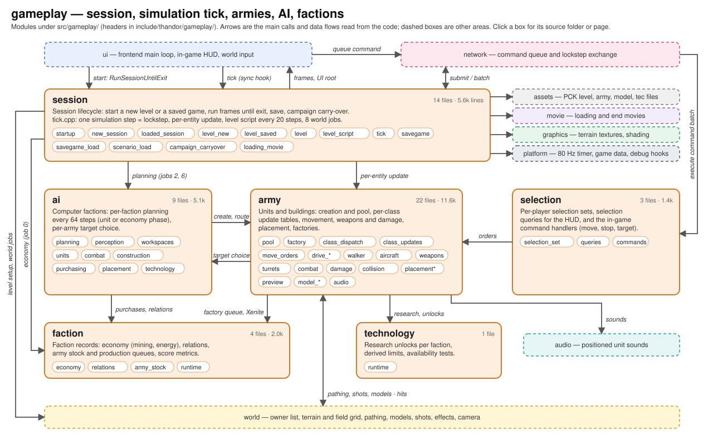

# gameplay

[Architecture overview](../README.md)

The gameplay area runs a game session: it starts a new level or a saved game, runs the simulation step and tears the session down again. One simulation step does the multiplayer lockstep, updates every entity (units and buildings in `army`, shots and effects in `world`), evaluates the level script and runs one of eight world jobs: faction economy, AI planning, terrain and grid upkeep. The `army`, `ai`, `faction`, `selection` and `technology` modules hold the game rules. `world` holds the entity list and the terrain they act on.

The boxes are clickable when you open [gameplay.svg](gameplay.svg) on its own. In this page, use the table below.

## Modules

| Module | Responsibility | Key files | Public headers |
| --- | --- | --- | --- |
| [session](../../../src/gameplay/session/) | Session lifecycle and the simulation tick: new and loaded sessions, the session frame loop and shutdown, level loading (LEV and save packages), the level script (conditions and end triggers), save games, campaign unit carry-over, the loading movie | [startup.cpp](../../../src/gameplay/session/startup.cpp), [tick.cpp](../../../src/gameplay/session/tick.cpp), [new_session.cpp](../../../src/gameplay/session/new_session.cpp), [loaded_session.cpp](../../../src/gameplay/session/loaded_session.cpp), [level_new.cpp](../../../src/gameplay/session/level_new.cpp), [level_saved.cpp](../../../src/gameplay/session/level_saved.cpp), [level_script.cpp](../../../src/gameplay/session/level_script.cpp), [savegame.cpp](../../../src/gameplay/session/savegame.cpp), [savegame_load.cpp](../../../src/gameplay/session/savegame_load.cpp), [scenario_load.cpp](../../../src/gameplay/session/scenario_load.cpp), [campaign_carryover.cpp](../../../src/gameplay/session/campaign_carryover.cpp), [loading_movie.cpp](../../../src/gameplay/session/loading_movie.cpp) | [session.h](../../../include/thandor/gameplay/session.h), [session/](../../../include/thandor/gameplay/session/) |
| [army](../../../src/gameplay/army/) | Units and buildings: the army pool and creation from army assets, the per-class handler tables (update, placement checks, class commands, influence), ground, walker, banking and aircraft movement, move orders, weapons, turrets, damage, collision, placement and preview, factories, unit sounds | [class_dispatch.cpp](../../../src/gameplay/army/class_dispatch.cpp), [class_updates.cpp](../../../src/gameplay/army/class_updates.cpp), [pool.cpp](../../../src/gameplay/army/pool.cpp), [factory.cpp](../../../src/gameplay/army/factory.cpp), [move_orders.cpp](../../../src/gameplay/army/move_orders.cpp), [walker.cpp](../../../src/gameplay/army/walker.cpp), [aircraft.cpp](../../../src/gameplay/army/aircraft.cpp), [weapons.cpp](../../../src/gameplay/army/weapons.cpp), [damage.cpp](../../../src/gameplay/army/damage.cpp), [placement.cpp](../../../src/gameplay/army/placement.cpp) | [army.h](../../../include/thandor/gameplay/army.h), [army/](../../../include/thandor/gameplay/army/) |
| [ai](../../../src/gameplay/ai/) | Computer factions: the planning phase per faction (perception workspaces, unit behaviour and group targets, construction requests, purchase candidates, research), and the target choice of each army | [planning.cpp](../../../src/gameplay/ai/planning.cpp), [perception.cpp](../../../src/gameplay/ai/perception.cpp), [workspaces.cpp](../../../src/gameplay/ai/workspaces.cpp), [units.cpp](../../../src/gameplay/ai/units.cpp), [combat.cpp](../../../src/gameplay/ai/combat.cpp), [construction.cpp](../../../src/gameplay/ai/construction.cpp), [purchasing.cpp](../../../src/gameplay/ai/purchasing.cpp), [placement.cpp](../../../src/gameplay/ai/placement.cpp), [technology.cpp](../../../src/gameplay/ai/technology.cpp) | [ai.h](../../../include/thandor/gameplay/ai.h), [ai/](../../../include/thandor/gameplay/ai/) |
| [faction](../../../src/gameplay/faction/) | The faction records (`g_GameFactionRuntimeImage`): Xenite and Tritium mining, energy allocation, pairwise relations, army stock and production queues, progress and score metrics | [economy.cpp](../../../src/gameplay/faction/economy.cpp), [relations.cpp](../../../src/gameplay/faction/relations.cpp), [army_stock.cpp](../../../src/gameplay/faction/army_stock.cpp), [runtime.cpp](../../../src/gameplay/faction/runtime.cpp) | [faction.h](../../../include/thandor/gameplay/faction.h), [faction/](../../../include/thandor/gameplay/faction/) |
| [selection](../../../src/gameplay/selection/) | Per-player selection sets, selection queries used by the HUD, and the in-game command handlers that turn a selection into orders (move, waypoint, target, stop, self-destruct) | [commands.cpp](../../../src/gameplay/selection/commands.cpp), [queries.cpp](../../../src/gameplay/selection/queries.cpp), [selection_set.cpp](../../../src/gameplay/selection/selection_set.cpp) | [selection.h](../../../include/thandor/gameplay/selection.h), [selection/](../../../include/thandor/gameplay/selection/) |
| [technology](../../../src/gameplay/technology/) | Research per faction: unlocking, availability tests, starting research on a building, derived limits and category masks | [runtime.cpp](../../../src/gameplay/technology/runtime.cpp) | [technology.h](../../../include/thandor/gameplay/technology.h), [technology/](../../../include/thandor/gameplay/technology/) |

## Main flows

### Starting and running a session

1. The frontend main loop (`ui/frontend/main_loop.cpp`) calls `InGameRuntime_RunSessionUntilExit` with the loaded level and a flag that says new or saved game.
2. A new game goes through `InGameRuntime_InitializeNewSession` (`new_session.cpp`):
   - `InGameNewSession_ResetSessionState` resets the tick state (`InGameSession_ResetTickState`, which starts the session paused and waiting for players). It then installs the step timer and the tick hook (`InGameSession_InstallStepTimerAndHooks`): an 80 Hz periodic timer (`InGameRuntime_PeriodicCountdownAndClockTick`) and `InGameRuntime_UpdateSimulationAndNetworkTick` as the UI synchronization hook (`UiRuntime_SetSynchronizationHooks`).
   - `InGameSession_CreateRoot` allocates the world object pool and the in-game UI root. It installs the world input callbacks from `ui/ingame` and pushes the root onto the UI root stack.
   - `InGameNewSession_LoadWorld` opens the loading movie (`InGameSession_OpenLoadingMovieAndAttachObjects`), calls `GameData_ResetDefaults` and then `InGameLevelRuntime_LoadResourcesAfterDefaultReset` (`level_new.cpp`). That function validates the LEV image, loads the technology file and the EFF, SHT, MDL and ARM lists through `Package_LoadEntry`, sets up terrain and graphics, places the start camera and spawns the initial armies with `ArmyRuntime_CreateInstanceFromAsset`. It also loads the spatial sounds and level samples and applies the default build lists and initial relations. Each loading stage advances the movie through `MoviePlayback_AdvanceScheduledFrameAndTick`, which also runs a tick.
   - `InGameNewSession_FinishWorldUnderTickLock` takes the tick spin lock and merges campaign units (`OldUnitRuntime_MergeMasksAndReplayRecords`). It allocates the pathing scratch and rebuilds the derived grids (`InGameSession_AllocateGridScratchAndRebuildDerived`, which includes `TechnologyRuntime_RebuildDerivedLimitsAndCategoryMasks`) and the HUD build grids.
   - `InGameSession_ReportReadyAndWaitForPlayers` issues the "player loaded" command and draws the player-status screen. It keeps calling the tick until no player is outstanding.
3. A saved game goes through `InGameRuntime_InitializeLoadedSession` (`loaded_session.cpp`), which follows the same steps with different loading. It calls `GameData_LoadExternalTables`, loads the saved field grid and runs `InGameLevelRuntime_LoadResourcesAfterExternalTables` (`level_saved.cpp`), which restores the army, model, shot and effect pools and rebases their pointers (`SavedLevel_LoadRuntimePools`, `savegame_load.cpp`).
4. The frame loop then calls `UiFrame_ProcessAndPresent` until a UI flag reports that the session closed, the end movie is due or the local player left. `InGameRuntime_ShutdownAndReleaseResources` then releases the world, the UI root, textures and the movie.

### One simulation step (`InGameRuntime_UpdateSimulationAndNetworkTick`, `tick.cpp`)

The UI runtime calls the step whenever it releases the in-game tick lock. The loading loops and movie playback also call it directly. The step paces itself: it returns early while the lock is held, while the simulation is more than two steps ahead of drawing, or until the 80 Hz timer has counted down (at most 20 steps per second).

1. **Lockstep.** `InGameTick_RunHostOrLocalLockstep` handles the host and single player, `InGameTick_RunClientLockstep` the clients. The host takes peer submissions (`FrontendTransfer_HostHandleCommandSubmitOrWaitAck`) and broadcasts the batch. At each interval boundary it runs the staged commands (`FrontendTransfer_DispatchStagedCommandRecords`). A client waits for the host's batch and runs it (`FrontendNetwork_HandleCommandBatchAndPlayerTimeout`). In a networked game, this is the point where player commands take effect.
2. If the session is not paused or waiting for players, `InGameTick_RunSimulationStep` advances `simulationTick`. It then calls `g_RuntimeMaintenanceCallbackPhases.primaryUpdate[ownerClassId]` for every node of the world owner list:
   - for an army, `ArmyRuntimeMaintenance_UpdateHierarchyAiAndTimers` (`army/class_dispatch.cpp`). It runs the class update from `g_ArmyRuntimeOrderHandlerMatrix11Columns24Classes.runtimeUpdate` (movement, turrets, factories, aircraft and so on), health, dismantling and research bookkeeping. For a non-neutral faction it also calls `AiCombatDecision_UpdateTargetAssignment`.
   - for shots and effects, the entries in `world/shots` and `world/effects`.
3. Every 20 steps `InGameConditionRuntime_UpdateScheduledRecords` (`level_script.cpp`) evaluates the 64 level conditions and the 16 end triggers. A trigger that fires ends its faction and can set the end-movie flag that closes the session.
4. One world job runs per step, chosen by `simulationTick & 7`:
   - 0: faction economy (`InGameRuntime_UpdateFactionResourceExtractionAndEnergyAllocationState`), the HUD metric cache, technology sync between allied factions (`GameFactionRuntime_SynchronizeTechnologiesForRelationStates8To10`) and terrain lighting
   - 2 and 6: AI planning (`AiFactionRuntime_RebuildPlanningCapacityState`)
   - 1 and 5: terrain height relaxation
   - 3: field-grid clamp and per-entity terrain state
   - 4: influence bands
   - 7: occupancy rebuild

### A player command

1. World input or hotkeys in `ui/ingame` call `InGameCommand_Issue<Handler>` (`include/thandor/network/protocol/commands.h`). For example, `world_input.cpp` issues `InGamePlayerSelection_ApplyMoveCommand` for a plain click on the ground.
2. In a local game the handler runs at once with `g_LocalPlayerRuntimeId`. In a networked game the handler's code from the in-game command table (`network/protocol/commands.cpp`) goes into the local command queue. The command is sent with the next batch, and every peer runs it in step 1 of the tick above.
3. The handler resolves the player's selection (`g_SelectionPlayerRuntimeBlockPointers[playerId]->selection`) and orders each entry. For a move this is `SelectionPointerArray_ApplyMoveCommand`, which calls `ArmyRuntime_StartRoutedMoveCommand` (`army/move_orders.cpp`), and that function routes through `EntityPathing_ResolveDestinationAndRebuildRoutes` in `world/pathing`. The class update in later steps then drives the unit along its route.
4. The same table also has faction handlers: relation changes and army stock or production orders (`GameFactionRuntime_RegisterArmyAssetPointers`, `GameFactionRuntime_ConsumePendingArmyAssetAndRefreshGrid`).

### What an AI faction does

- **Planning (every 64 steps per faction).** `AiFactionRuntime_RebuildPlanningCapacityState` runs on world jobs 2 and 6. It calls `AiRuntime_DispatchFactionPlanningPhase` for each active faction that has no player block. Bits 3 to 5 of `simulationTick` pick the faction and bit 6 picks the phase. In both phases `AiPlanning_RebuildFactionWorkspaces` (`perception.cpp`) first rebuilds the faction's view of the map.
  - **Unit phase:** `AiUnitBehavior_UpdateOwnUnits` (`units.cpp`), then `AiUnitGroup_AssignCollectedEntitiesToBestTarget` (`combat.cpp`), which orders groups with `ArmyRuntime_ResolveCommandTargetAndRoute`.
  - **Economy phase:** `GameFactionRelations_UpdateAllPairsForFaction` (`faction/relations.cpp`), then `AiConstructionPlanner_ProcessPendingAssetRequests` (`construction.cpp`), which creates buildings with `ArmyRuntime_CreateInstanceFromAsset` and starts them with `ArmyRuntime_DispatchClassCommand`. If no construction request was handled, the AI collects purchase candidates (power, storage, defence, exploration, attack, factory stage, research) and spends Xenite on them with `AiPurchasePlanner_ExecuteAffordableCandidates` (`purchasing.cpp`). An army purchase goes into the faction's pending asset list (`GameFactionRuntime_RegisterArmyAssetPointers`). A research purchase starts on an idle building (`Technology_ApplyRecordToEntity`).
- **Every step, per army:** `AiCombatDecision_UpdateTargetAssignment` picks the army's target.
- **Factories.** These run in the army class updates, not in the AI. `ArmyRuntimeClass_UpdateUnitFactory` and `ArmyRuntimeClass_UpdateStructureFactory` (`army/factory.cpp`) take queued assets from the faction record, pay their Xenite and create the army. This works the same for AI and human factions.

### Saving

`ui/ingame/savegame_page.cpp` calls `InGameSaveGame_WritePackage` (`savegame.cpp`). It raises the busy count that pauses the periodic clock and hands every player's pending army asset back to its faction. It then writes the package (faction image, army, model, shot and effect pools with pointers converted to offsets, field grid, campaign carry-over tables).

## Interfaces to other areas

**Who calls gameplay**

- [ui](../ui/README.md): the frontend starts sessions (`InGameRuntime_RunSessionUntilExit`) and the UI runtime runs the tick as its synchronization hook. `ui/ingame` issues player commands, reads selection queries (`SelectionInfo_*`), places and previews buildings (`ArmyPlacement_*`, `ArmyRuntime_CreateInstanceFromAsset`), builds the build and stock grids from faction and technology state, and starts saves.
- [network](../network/README.md): the in-game command table (`network/protocol/commands.cpp`) points at handlers in `selection` and `faction`. It also loads the scenario field grid on request (`FrontendScenarioSession_LoadOrRequestFieldGrid`).
- [world](../world/README.md): shots apply hits to armies (`ArmyRuntime_ApplyImpactDamageToRuntimeAndParent`, `ShotRuntime_ApplyArmyHitRelationAndNotifications`). Effects can spawn an army (`EffectLifecycle_SpawnArmyFromOwner`). Pathing and the model pool use the army class tables.
- [platform](../platform/README.md): debug tools and the state hash read faction, selection and army state. Bootstrap sets up the AI workspace (`AiRuntime_InitWorkspace`) and mounts level packages (`LevelPackage_ValidateAndMount`).

**What gameplay calls**

- [world](../world/README.md): the owner list (`WorldRuntime_ForEachOwnerListNode`), terrain and field grid (`FieldGrid_*`, `TerrainGrid_*`, lighting), pathing (`EntityPathing_ResolveDestinationAndRebuildRoutes`, `GridScratch_*`, `GridInfluence_*`), the model pool and transforms (`ModelRuntimePool_*`, `ModelNodeRuntime_*`), shots and effects created by weapons (`ShotRuntimePool_CreateProjectileFromDefinition`, `EffectRuntimePool_CreateInstanceFromDefinition`), and the camera when a level loads.
- [assets](../assets/README.md): `Package_*` for level, technology and save packages. `ArmyAsset_PrepareRecords`, `ModelAsset_PrepareRecords`, `ShotAsset_PrepareEntries` and `EffectAsset_PrepareEntries` prepare loaded files, and the army and model registries are used for lookups.
- [ui](../ui/README.md): the frame loop (`UiFrame_ProcessAndPresent`, `UiFrame_Draw`), the UI root stack, the notification queue (`InGameNotificationQueue_InsertPriorityRecord`), the HUD grids (`InGameBuildCatalog_RebuildGrid`, `InGameArmyStock_RebuildGrid`), and the runtime flags in `g_UiCommandRuntimeFlags` (pause, waiting for players, session closed).
- [network](../network/README.md): the lockstep functions in `network/protocol` called from `tick.cpp`.
- [graphics](../graphics/README.md): terrain visual resources, the shading texture, the army, shot and effect texture sets, and framebuffer fill and present at shutdown.
- [movie](../movie/README.md): `Movie_Open`, `Movie_AdvanceFrame` and `Movie_Close` for the loading movie, and the end movie through the frontend.
- [audio](../audio/README.md): positioned unit sounds (`SpatialSound_PlayPositionedOneShot`), spatial sound slots and level samples, and stopping all voices at session end.
- [platform](../platform/README.md): the periodic timer, `GameData_ResetDefaults` and `GameData_LoadExternalTables`, the file system for save directories, and `DebugHook_*` around sessions and steps.
- [core](../core/README.md): fixed-point maths and the random generator (`g_RandomGeneratorState`), persistent settings (`PersistentSettings_Read`), and wide paths.

## Notes

- **Shared state.** Most simulation state lives in globals, not objects: the faction image `g_GameFactionRuntimeImage` (including `simulationTick`), the in-game root `g_InGameRuntimeRoot` with its `worldRuntime`, and the per-player selection blocks. Save games copy these images, so their layout matters.
- **Timer thread.** `InGameRuntime_PeriodicCountdownAndClockTick` runs on the timer thread. It shares the network countdown, the clock tick and the save busy count with the main loop. These are accessed through relaxed `std::atomic_ref` helpers in `tick.h`, and the simulation state itself is guarded by `g_InGameStateTickSpinLock`.
- **Determinism.** In a networked game every peer runs the same command batch at the same interval boundary, and the simulation uses the secondary random stream that the session seeds. The original game leaves a local game on the primary stream, which the frontend and UI also advance per drawn frame, so a local game's outcome depends on the frame rate (see the comment in `InGameRuntime_RunSessionUntilExit`).
- **Kept original behaviour.** Comments marked "Original quirk" record behaviour that was kept: the tick spin lock is not released when finishing the world fails, and an error from the saved-game table load reports the faction index as its error code. Comments marked "bounded here" record crash fixes.
