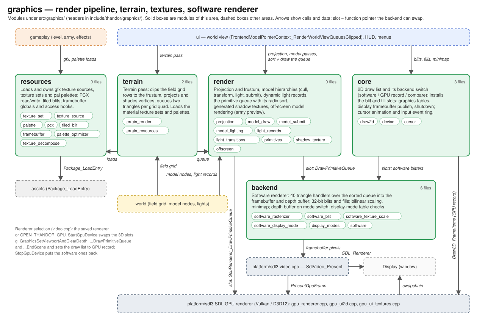

# graphics

[Architecture overview](../README.md)

The graphics area turns the 3D world view and the 2D user interface into pixels. Its CPU pipeline (projection, model and terrain transform, lighting, generated shadow textures, the primitive queue and its radix sort) is the same for every renderer. Only the last step goes through function-pointer slots: the software backend in this area draws the sorted queue and the 2D blits into a CPU framebuffer, while the SDL GPU renderer in [platform](../platform/README.md) swaps itself into the same slots and draws on Vulkan or Direct3D 12. Textures, texture sets and palettes are loaded from the PCK packages through [assets](../assets/README.md).

The boxes are clickable when you open [graphics.svg](graphics.svg) on its own. In this page, use the table below.

## Modules

| Module | Responsibility | Key files | Public headers |
| --- | --- | --- | --- |
| [render](../../../src/graphics/render/) | Projection and frustum planes, model hierarchies (cull, transform, per-vertex lighting, triangle submit), dynamic light records and their radius fades, the global primitive queue and its radix sort, generated shadow textures, off-screen model rendering into a texture (army preview) | [projection.cpp](../../../src/graphics/render/projection.cpp), [model_draw.cpp](../../../src/graphics/render/model_draw.cpp), [model_submit.cpp](../../../src/graphics/render/model_submit.cpp), [model_lighting.cpp](../../../src/graphics/render/model_lighting.cpp), [light_records.cpp](../../../src/graphics/render/light_records.cpp), [light_transitions.cpp](../../../src/graphics/render/light_transitions.cpp), [primitives.cpp](../../../src/graphics/render/primitives.cpp), [shadow_texture.cpp](../../../src/graphics/render/shadow_texture.cpp), [offscreen.cpp](../../../src/graphics/render/offscreen.cpp) | [render.h](../../../include/thandor/graphics/render.h) and `render/*.h` |
| [terrain](../../../src/graphics/terrain/) | Terrain pass of the world view: clips the field grid rows to the frustum, projects and shades the vertices, queues two textured triangles per grid quad; loads and releases the terrain texture sets, palettes and packet tables | [terrain_render.cpp](../../../src/graphics/terrain/terrain_render.cpp), [terrain_resources.cpp](../../../src/graphics/terrain/terrain_resources.cpp) | [terrain.h](../../../include/thandor/graphics/terrain.h) and `terrain/*.h` |
| [resources](../../../src/graphics/resources/) | `gfx` texture sources, texture sets and `pal` palettes (load, validate, clone, release), texture slots, PCX decode and screenshot encode, tiled blits, framebuffer globals and access hooks; converter-only code (palette optimiser, sprite-sheet decomposition) with no caller in the game | [texture_set.cpp](../../../src/graphics/resources/texture_set.cpp), [texture_source.cpp](../../../src/graphics/resources/texture_source.cpp), [palette.cpp](../../../src/graphics/resources/palette.cpp), [pcx_read.cpp](../../../src/graphics/resources/pcx_read.cpp), [pcx_write.cpp](../../../src/graphics/resources/pcx_write.cpp), [tiled_blit.cpp](../../../src/graphics/resources/tiled_blit.cpp), [framebuffer.cpp](../../../src/graphics/resources/framebuffer.cpp), [palette_optimizer.cpp](../../../src/graphics/resources/palette_optimizer.cpp), [texture_decompose.cpp](../../../src/graphics/resources/texture_decompose.cpp) | [resources.h](../../../include/thandor/graphics/resources.h) and `resources/*.h` |
| [core](../../../src/graphics/core/) | The 2D draw list and its backend switch (software, GPU record, compare) that installs the blit and fill slots; graphics table allocation, display framebuffer publish and shutdown; cursor animation and the pointer event ring | [draw2d.cpp](../../../src/graphics/core/draw2d.cpp), [device.cpp](../../../src/graphics/core/device.cpp), [cursor.cpp](../../../src/graphics/core/cursor.cpp) | [core.h](../../../include/thandor/graphics/core.h), `core/draw2d.h`, `core/runtime.h`, `core/cursor.h`, `core/types.h` |
| [backend](../../../src/graphics/backend/) | Software renderer: 40 triangle handlers (32-bit and auxiliary family) over the sorted queue with a depth buffer, 32-bit blits and fills, bilinear texture scaling and minimap, depth buffer reallocation on mode switch, display-mode table checks, start-up factor tables | [software_rasterizer.cpp](../../../src/graphics/backend/software_rasterizer.cpp), [software_raster.h](../../../src/graphics/backend/software_raster.h), [software_blit.cpp](../../../src/graphics/backend/software_blit.cpp), [software_texture_scale.cpp](../../../src/graphics/backend/software_texture_scale.cpp), [software_display_mode.cpp](../../../src/graphics/backend/software_display_mode.cpp), [display_modes.cpp](../../../src/graphics/backend/display_modes.cpp), [software.cpp](../../../src/graphics/backend/software.cpp) | [backend.h](../../../include/thandor/graphics/backend.h) and `backend/*.h` |

The rasterizer handlers are explained in [software_raster.md](../../software_raster.md).

## Main flows

### One world frame, from scene to present

1. `FrontendModelPointerContext_RenderWorldViewQueuesClipped` (ui, `src/ui/frontend/menu_room.cpp`) is the draw method of the 3D view in the menu room and in game. It starts the scene with the slot `g_GraphicsSetViewportAndClearDepth`.
2. Camera set-up in render/projection: `Graphics_SetProjectionClipRect`, `Graphics_SetViewProjectionParameters`, `Graphics_SetProjectionViewport`, `Graphics_SetAuxiliaryOrientation`, `Graphics_SetSceneBoundsAndColors`, `Graphics_RebuildFrustumPlanes`. Then `GraphicsShadingRuntime_RebuildCompactLightingRecords` copies the active light records into view space.
3. Up to four passes. Each one takes a fresh queue (`GraphicsPrimitiveQueue_ResetGlobal`, `Graphics_SetActivePrimitiveQueue`), fills it, then sorts it with `g_GraphicsPrimitiveQueueRadixSortProc` (`GraphicsPrimitiveQueue_RadixSortForRendering`) and hands it to the slot `g_GraphicsDrawPrimitiveQueue`:
   - models drawn before the terrain: `ModelRuntime_CullAndRenderHierarchyRecursive` → `ModelRender_SubmitTriangle` (`Graphics_ProjectViewPoint`, `ModelRender_ComputeVertexIntensityDefaultPath` / `...ScaledPath`) → `GraphicsPrimitiveQueue_AppendTriangle`;
   - terrain: `TerrainProjectedGrid_TransformShadeAndQueue` (see below);
   - shading: `GraphicsShadingGeneratedTexture_ResetPassScratchAndClearAlphaPlanes`, `GraphicsShadingGeneratedTexture_ProcessRenderableHierarchy` per model (rasterizes the silhouette into a shadow texture tile and builds a textured patch on the terrain), `GraphicsShadingGeneratedTexture_RefreshTouchedAlphaSubresources`;
   - the remaining models, as in the first pass.
4. The scene ends with the slot `g_GraphicsEndScene`, and `Draw2D_MarkExternal3D` puts a marker for the 3D rectangle into the 2D draw list (GPU record mode only).
5. The HUD and menus draw through the 2D slots (`g_GraphicsTextureSourceBlitSourceAlpha`, `g_GraphicsFramebufferFillRectArgb`, `g_GraphicsMinimapDraw`, ...). `Draw2D_InstallSlots` points them at the software blitters (`SoftwareTextureSource_BlitSourceAlpha32`, ...) or at the draw-list record functions.
6. `SdlVideo_Present` (platform) shows the frame. If the GPU recorded it, `PresentGpuFrame` replays the draw list (`Draw2D_FrameItems`) and draws the waiting 3D scene at the `EXTERNAL_3D` item. Otherwise the cursor is composed into the CPU framebuffer and the framebuffer is uploaded to an SDL_Renderer texture.

Software 3D path: `SoftwareRenderer_DrawPrimitiveQueueBridge` → `g_GraphicsFramebufferBeginAccess` → `SoftwareRenderer_DrawQueue32Bit` → `SoftwareRenderer_PrepareTrianglePacket` per packet → `SoftwareRaster32_ModeNN` picked from the render flags. GPU 3D path: `GpuRenderer_DrawPrimitiveQueue` copies the sorted queue into GPU vertices and draw runs, and the scene is drawn at present. Lighting, projection, culling and sorting stay on the CPU in both paths, so the simulation and the state hash do not depend on the renderer.

### Terrain rendering

- Loading (called from gameplay): `TerrainVisualResources_LoadPrimary` (new level, `level_new.cpp`) or `TerrainVisualResources_LoadAndClearCellOverlayFlags` (saved game, `level_saved.cpp`) → `TerrainVisualResources_LoadTablesAndPalettes` loads the primary texture set through `g_GraphicsTextureSetLoadPackage`, the palettes through `g_GraphicsPaletteAssetLoadPackage` and the soil and surface packet tables through `Package_LoadEntryWithSize`. `TerrainVisualResources_LoadMaterialTextureSets` loads the material sets with suffixes `a`..`z` into `g_TerrainMaterialTextureSets`. `TerrainVisualResources_Shutdown` releases everything at level end.
- Per frame: `TerrainProjectedGrid_TransformShadeAndQueue` reuses the previous projection when `TERRAIN_RENDER_REUSE_PROJECTION` is set. Otherwise it narrows the visible column span of each grid row with `TerrainProjectedGrid_ClipRowSpansAgainstPlane`. It then updates each vertex with `TerrainProjectedVertex_TransformProjectAndShade` (full) or `TerrainProjectedVertex_ReshadeKeepingProjection` (view and grid unchanged), and queues each quad as two textured triangles into the active primitive queue.

### Texture and palette loading

- Texture sets: `g_GraphicsTextureSetLoadPackage` = `GraphicsTextureSet_LoadPackage` → `Package_LoadEntry` (assets) → `g_GraphicsCreateTextureSet`. That slot defaults to `GraphicsTextureSet_AllocateMetadata`, and `video.cpp` sets it to `GraphicsTextureSet_Create`. Released with `GraphicsTextureSet_ReleasePackage`.
- Texture sources: `GraphicsTextureSource_LoadPackageAsset` → `Package_LoadEntry` → `GraphicsTextureSource_ValidateAsset` → `g_GraphicsTextureSourceConvertPaletteEntries`. `GraphicsTextureSource_CloneAsset` makes a private copy that can be changed.
- Palettes: `GraphicsPaletteAsset_LoadPackage` → `Package_LoadEntry` → `g_GraphicsPaletteAssetValidate`.
- Users are the terrain loader, the generated shadow texture set (`g_GraphicsCreateTextureSet` in `shadow_texture.cpp`) and, outside this area, the ui (fonts, windows, credits, in-game layout), gameplay (army pool), world (effect and shot pools) and platform start-up.

### Renderer selection: GPU or software

- `video.cpp` (platform) chooses the renderer. `ForcedRenderer` reads `OPEN_THANDOR_GPU` or the `-SOFTWARE` / `-GPU` command-line options; otherwise the saved choice `PERSISTENT_SETTING_RENDERER` from `thandor.ini` is used (Vulkan, Direct3D 12 or Software). `RendererAvailable` probes the GPU drivers, and `StartRenderer` starts the chosen one.
- GPU: `StartGpuDevice` sets the 2D draw list to `DRAW2D_BACKEND_GPU_RECORD` (or `DRAW2D_BACKEND_COMPARE`) through `Draw2D_SetBackend` and replaces the three 3D slots with `GpuRenderer_SetViewportAndClearDepth`, `GpuRenderer_DrawPrimitiveQueue` and `GpuRenderer_EndScene`. `StopGpuDevice` restores `SoftwareRenderer_ClearViewport`, `SoftwareRenderer_DrawPrimitiveQueueBridge` and `SoftwareGraphicsDispatch_NoOp`.
- Display mode: `SdlVideo_ApplyDisplayMode` calls `GraphicsDisplay_PublishFramebuffer`, which sets up `g_DisplayFramebufferAccess` and calls `Draw2D_InstallSlots`. The software renderer's depth buffer follows the mode through the hook that `SoftwareRenderer_InstallDisplayModeHook` chains into `g_GraphicsSetDisplayMode`.
- Compare mode (`OPEN_THANDOR_GPU=compare`, developer tools only) draws every frame in both renderers and shows the software picture.

## Interfaces to other areas

What graphics calls:

- [assets](../assets/README.md): `Package_LoadEntry` and `Package_LoadEntryWithSize` for `gfx`, `pal` and terrain table entries, and `Resource_Release`.
- [platform](../platform/README.md): the software backend draws into the framebuffer pixels that `video.cpp` owns (`g_DisplayFramebufferAccess.pixels`). The SDL GPU renderer replaces the 3D slots and reads the 2D draw list. The present slot `g_GraphicsFramebufferPresent` is called by ui and gameplay, not by graphics. The optional high-resolution font (`[game] hd_font`, UI scale 2 and 3) does not pass through graphics either: the draw list still records the original glyph, and the GPU renderer swaps in its high-resolution form (`HdFont_GlyphSource`, `ui/text/hd_font.cpp`) when it looks up the texture region; the software backend always draws the original font.
- [core](../core/README.md): `g_MemoryApi` for tables, depth buffers and texture copies; fixed-point transforms such as `FixedTransform_ApplyPoint`. In the other direction, `Runtime_Shutdown` (`src/core/memory/synchronization.cpp`) calls `Graphics_Shutdown`.

Who calls graphics:

- [ui](../ui/README.md): runs the world view frame (render, terrain, slots); draws HUD and menus through the 2D slots; projects points for selection overlays and world input (`Graphics_ProjectViewPoint`); decodes PCX previews (`Pcx_DecodeIndexed8`); advances the light fades once per simulation step (`InterpolationStateTable_Advance256ByTicks` in `root_frame.cpp`); the map editor reads `g_TerrainMaterialTextureSets`.
- [gameplay](../gameplay/README.md): loads and releases the terrain visuals at level start and end; renders the army preview through `g_GraphicsOffscreenRenderModelListToTextureSource`; saves and loads the light record table `g_GraphicsShadingRuntimeRecords`.
- [world](../world/README.md): owns the field grid and the model nodes that the passes draw; effects and shots write the dynamic light records; model picking uses `Graphics_ProjectViewPoint`.
- [platform](../platform/README.md): start-up calls `SoftwareRenderer_BuildFactorTables`, `GraphicsLighting_BuildPackedLookupTable`, `GraphicsIntensityClampTable_Initialize`, `SoftwareRenderer_InstallDisplayModeHook`, `GraphicsPrimitiveQueue_AllocateGlobalPool` and `Graphics_AllocateTables`; screenshots use `Pcx_EncodeCapture`; the input layer registers `GraphicsCursor_AdvanceAnimationAndRefreshPrimaryTimer` as a periodic timer.

## Notes

- Only 32-bit colour is left. The original's 16-bit framebuffer paths (RGB565 blits, the `SoftwareRaster16` family, 16-bit display modes) were removed.
- `Graphics_AllocateTables` still allocates a 256-entry palette table that is no longer read. This keeps the arena layout, and with it the texture-set addresses that the radix sort uses to order opaque packets, the same as before.
- The bilinear factor tables keep an original quirk: entry 256 is read when the lighting cycle phase is 0 and holds the values the original read from the next table (see `SoftwareRenderer_BuildFactorTables`).
- The GPU renderer has two rasterizations (`[graphics] gpu_rasterization`): *smooth* (default, sub-pixel and perspective-correct like the original's Direct3D renderer) and *exact* (rebuilds the software rasterizer's pixel-snapped affine triangles).
- The auxiliary raster family (off-screen army preview) skips textured packets whose texture is subresource 99 or 113 of its source. Which textures these are is not known.
