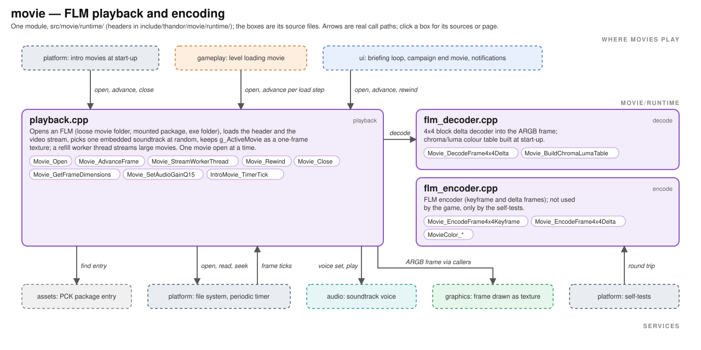

# movie

[Architecture overview](../README.md)

The movie area plays the game's FLM movies: intro films, the level loading movie, mission briefings, the campaign end movie and the small in-game notification movies. It is a single module, `movie/runtime`, that opens an FLM file, streams its video data, decodes one 4x4-block delta frame at a time into an ARGB image and starts one of the embedded `.sam` soundtracks through the audio backend. The decoded frame is laid out like a one-frame texture, so callers draw it with the normal texture and UI code; timing is up to the caller.

The boxes are clickable when you open [movie.svg](movie.svg) on its own. In this page, use the table below. Since the area has one module, the diagram shows its three source files.

## Modules

| Module | Responsibility | Key files | Public headers |
| --- | --- | --- | --- |
| `movie/runtime` | Open / advance / rewind / close of the single active movie (`g_ActiveMovie`), streaming refill worker, soundtrack selection and start, frame timer tick for the intro; FLM frame decoder and its colour table; FLM encoder (self-tests only) | [`playback.cpp`](../../../src/movie/runtime/playback.cpp), [`flm_decoder.cpp`](../../../src/movie/runtime/flm_decoder.cpp), [`flm_encoder.cpp`](../../../src/movie/runtime/flm_encoder.cpp) | [`runtime.h`](../../../include/thandor/movie/runtime.h), [`playback.h`](../../../include/thandor/movie/runtime/playback.h), [`flm_decoder.h`](../../../include/thandor/movie/runtime/flm_decoder.h), [`flm_encoder.h`](../../../include/thandor/movie/runtime/flm_encoder.h), [`types.h`](../../../include/thandor/movie/runtime/types.h) |

## Main flows

**Opening a movie.** `Movie_Open(flags, path, &rate, &error)` looks for the file in the loose movie folder (`g_LooseMoviePathPrefix`, skipped with `MOVIE_OPEN_PACKAGE_ONLY`), then in the mounted packages (`Package_FindEntryAcrossMounts`), then next to the executable, then at the plain path. It reads the 0x200-byte header, checks it (`Movie_IsHeaderValid`), allocates the FLM buffer and reads the video stream; with `MOVIE_OPEN_STREAM` only its first part is read. `Movie_OpenLoadRandomAudioTrack` picks one of up to 14 soundtracks at random, reads it from behind the video stream and turns it into a voice set with `g_SoundCreateSampleVoiceSet`. The `MovieRuntime` gets a texture header in front of its ARGB pixels and the soundtrack gain `g_MovieDefaultAudioGainQ15`; a partly loaded movie gets a refill worker (`Movie_StartStreamWorker`, `Movie_StreamWorkerThread`). The returned rate is the header's frame timer rate for `g_TimerRegisterPeriodic`.

**Decoding and timing.** Each `Movie_AdvanceFrame(&movie, &endCode)` call decodes the next frame with `Movie_DecodeFrame4x4Delta` into the movie's ARGB image. Along the way it asks the worker for the next chunk (the refill semaphore) while the buffer has room, drops played bytes from the buffer front (`Movie_CompactStreamBuffer`), and returns without decoding while a streamed movie has less than one chunk buffered. It returns false after the last frame or on a read error. The decoder reads its colours from `g_MovieChromaLumaToArgb`, which `Movie_BuildChromaLumaTable` fills at start-up (`platform/bootstrap/main.cpp`). The movie does not time itself: the intro registers `IntroMovie_TimerTick` at the movie's rate and decodes as many frames as ticks are pending (at most three per pass, `IntroMovie_PresentPendingFrames`); other callers advance once per UI tick or per loading step.

**Sound.** On the first `Movie_AdvanceFrame` the soundtrack voice set is played once with `g_SoundPlayOneShot` at the movie's gain. `Movie_SetAudioGainQ15` changes that gain before the first frame, `Movie_Rewind` stops the voice, and `Movie_Close` stops the worker, frees the buffers, releases the voice set (`g_SoundReleaseSampleVoiceSet`) and closes the stream. The settings pages and `CoreAssets_ApplySoundSettings` set `g_MovieDefaultAudioGainQ15` and `g_MovieAlternateAudioGainQ15` (both 0 while sound effects are switched off).

**Where movies play.**
- Intro: `Game_PlayIntroMovies` (platform bootstrap) plays `flm\intro0.flm`, `intro1.flm`, ... streamed, centred in the framebuffer with `g_GraphicsTextureSourceBlitSourceAlpha`; a key or mouse release skips one, `-NOINTRO` skips all.
- Loading: `InGameSession_OpenLoadingMovieAndAttachObjects` (`gameplay/session/startup.cpp`) opens the level movie from the package; while the level loads, `MoviePlayback_AdvanceScheduledFrameAndTick` and `MoviePlayback_AdvanceToFrameAndPresent` (`gameplay/session/loading_movie.cpp`) decode up to the frame for the current loading stage and redraw the UI, which shows the movie texture.
- Campaign: `FrontendMissionBriefingPage_Initialize` opens the briefing movie as the briefing image's texture, and `FrontendRoot_TickNetworkPagesMovieCursorAndScenarioState` advances it and calls `Movie_Rewind` at the end, so it loops. `Frontend_PlaySelectedEndMovie` (`ui/frontend/end_movie.cpp`) plays the campaign end movie streamed, timed by `FrontendSession_PeriodicTick`.
- In-game notifications: `InGameNotification_StartQueueHeadMovie` opens `flm\movieNNN.flm` as the notification button's texture (movies 100-299 and 700-899 use the alternate gain), and `InGameRuntime_ProcessQueuedSessionNotificationTimer` advances and closes it.
- Debug tools: `platform/debug/movie_player.cpp` plays and exports movies with the same calls.

## Interfaces to other areas

- [platform](../platform/README.md): file system (`g_FileSystemOpen`, `g_FileSystemReadExact`, `g_FileSystemSeek`), the periodic timer that drives `IntroMovie_TimerTick`, the intro sequence, the colour table built at start-up, the debug movie player, and the encoder and decoder self-tests (`platform/selftest/selftests.cpp`).
- [assets](../assets/README.md): `Package_FindEntryAcrossMounts` finds movies inside mounted PCK packages.
- [audio](../audio/README.md): the soundtrack becomes a voice set and plays through the `g_Sound*` slots. Not in the original: a quiet soundtrack (intro2, the story movies `ende00NN`) is raised with `g_SoundRaiseQuietSampleLevel` right after its voice set is created, while `OtFeature_Active(OT_FEATURE_MOVIE_VOLUME_BOOST)` holds (core, "Original Thandor" switch); the decoded length and so the timing stay the same.
- [graphics](../graphics/README.md): callers draw the frame as a texture source (`g_GraphicsTextureSourceBlitSourceAlpha` for the intro, UI image controls elsewhere).
- [gameplay](../gameplay/README.md): the level loading movie, advanced by the loading stages; sessions close the movie when they start or end.
- [ui](../ui/README.md): briefing, campaign end movie, in-game notification movies, and the movie volume sliders.
- [core](../core/README.md): arena allocator for the FLM buffer and the runtime; persistent settings for the movie gains.

## Notes

- Only one movie can be open. As in the original, a second `Movie_Open` replaces `g_ActiveMovie` without closing it (logged, and asserted in debug builds), because callers may still draw the old frame.
- The original shipped the chroma/luma colour table precomputed; open-thandor builds it with `Movie_BuildChromaLumaTable`. Streaming state shared with the worker thread uses atomics here; the original used plain reads and writes.
- Several original leaks and over-reads are bounded: a failed refill now closes the movie's own stream handle, `Movie_CompactStreamBuffer` moves the exact byte count, and the briefing and notification callers handle a movie without a first frame.
- The FLM encoder (`Movie_EncodeFlmBufferFromFrameProvider`, `Movie_EncodeFrame4x4Keyframe`, `Movie_EncodeFrame4x4Delta`) is not called by the game; the self-tests encode frames and decode them again.
