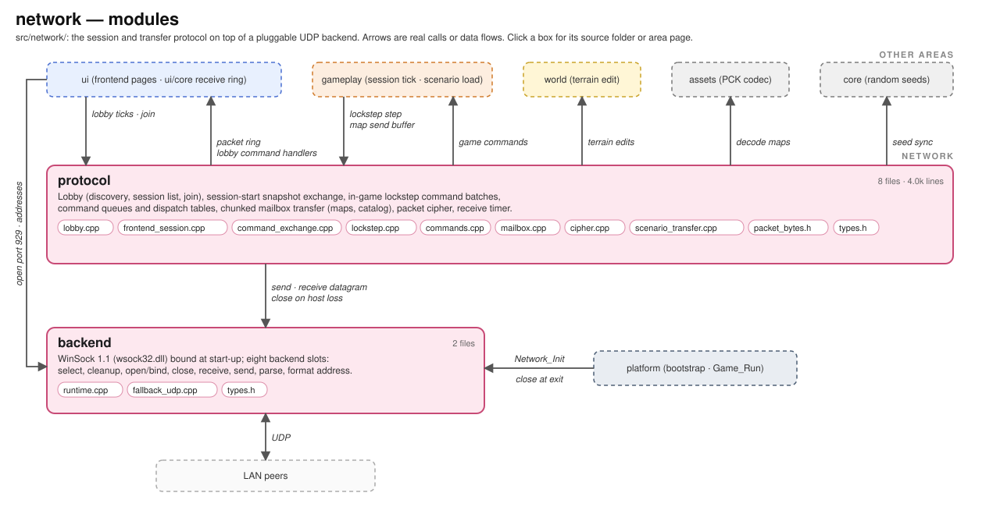

# network

[Architecture overview](../README.md)

The network area runs the original game's LAN multiplayer. `protocol` holds everything above the socket: the lobby (discovery, session list, join), the player-snapshot exchange at session start, the lockstep exchange of command batches during play, the command queues and dispatch tables, and a chunked "mailbox" transfer for maps and the scenario catalog. All packets are encrypted with a 16-round block cipher. `backend` is a table of eight function slots over WinSock 1.1 UDP. The frontend pages, the session tick and start-up/shutdown drive the area: network calls into `ui`, `gameplay` and `world` only to run received commands.

The boxes are clickable when you open [network.svg](network.svg) on its own. In this page, use the table below.

## Modules

| Module | Responsibility | Key files | Public headers |
| --- | --- | --- | --- |
| [protocol](../../../src/network/protocol/) | Lobby and session protocol, lockstep command exchange, command queues and dispatch, mailbox transfer, packet cipher | [lobby.cpp](../../../src/network/protocol/lobby.cpp), [frontend_session.cpp](../../../src/network/protocol/frontend_session.cpp), [command_exchange.cpp](../../../src/network/protocol/command_exchange.cpp), [lockstep.cpp](../../../src/network/protocol/lockstep.cpp), [commands.cpp](../../../src/network/protocol/commands.cpp), [mailbox.cpp](../../../src/network/protocol/mailbox.cpp), [scenario_transfer.cpp](../../../src/network/protocol/scenario_transfer.cpp), [cipher.cpp](../../../src/network/protocol/cipher.cpp) | [protocol.h](../../../include/thandor/network/protocol.h), `protocol/`: [lobby.h](../../../include/thandor/network/protocol/lobby.h), [frontend_session.h](../../../include/thandor/network/protocol/frontend_session.h), [command_exchange.h](../../../include/thandor/network/protocol/command_exchange.h), [lockstep.h](../../../include/thandor/network/protocol/lockstep.h), [commands.h](../../../include/thandor/network/protocol/commands.h), [mailbox.h](../../../include/thandor/network/protocol/mailbox.h), [scenario_transfer.h](../../../include/thandor/network/protocol/scenario_transfer.h), [cipher.h](../../../include/thandor/network/protocol/cipher.h), [packet_bytes.h](../../../include/thandor/network/protocol/packet_bytes.h), [types.h](../../../include/thandor/network/protocol/types.h) |
| [backend](../../../src/network/backend/) | Binds wsock32.dll, starts WinSock 1.1, installs the UDP backend into the eight slots `g_NetworkBackendSlot0..7` | [runtime.cpp](../../../src/network/backend/runtime.cpp), [fallback_udp.cpp](../../../src/network/backend/fallback_udp.cpp) | [backend.h](../../../include/thandor/network/backend.h), `backend/`: [runtime.h](../../../include/thandor/network/backend/runtime.h), [fallback_udp.h](../../../include/thandor/network/backend/fallback_udp.h), [types.h](../../../include/thandor/network/backend/types.h) |

What the protocol files hold:

- `lobby.cpp`: discovery probe and session advertisement, session list and join ack, admitting a joining player, capability heartbeat, lobby command batches. Not in the original: the pathing-mode negotiation (see Main flows).
- `frontend_session.cpp`: snapshot exchange at session start, the client side of the in-game command batch, host-loss timeout.
- `command_exchange.cpp`: client command submit, host collection and broadcast of the in-game batch, roster packets.
- `lockstep.cpp`: host lockstep helpers (`LockstepHostChannel`) shared by the lobby and the in-game exchange.
- `commands.cpp`: the local command queues (`FrontendCommandQueue_*`, `InGameCommandQueue_*`) and the command tables that map a protocol code to its handler (`CommandDispatch_ExecuteRecord`). In a local game, `InGameCommand_IssueHandler` hands each command to the game recorder first (`GameRecorder_Active`, `GameRecorderCommandScope`, gameplay/replay), which records it or blocks it during a playback.
- `mailbox.cpp`: receive loop, packet staging and encryption, chunked mailbox transfer, ping.
- `scenario_transfer.cpp`: decodes a received scenario catalog, level, field grid or bundle.
- `cipher.cpp`: `UiTransfer_EncryptPacketBlocks` / `UiTransfer_DecryptPacketBlocks`.

## Main flows

- **Start-up and transport.** `Game_Run` (platform/bootstrap) calls `Network_Init`. It loads wsock32.dll, resolves 14 exports, calls `WSAStartup(1.1)` and points `g_NetworkBackendSlot0..7` at the `NetworkFallback_*` UDP functions. Until then the slots hold `NetworkBackendFallback_*` defaults, which do nothing and fail safely. When a network page opens, `FrontendNetworkSetupPage_OpenBackend` / `FrontendNetworkSetup_OpenSelectedBackend` (ui/frontend/network.cpp) select the backend with slot 0 and open and bind UDP port `NETWORK_GAME_UDP_PORT` (929) with slot 2. Slots 6/7 parse and format peer addresses. At exit, `Game_Run` closes the socket (slots 3, 1) and `Runtime_Shutdown` (core) calls `Network_Shutdown` (`WSACleanup`).
- **Receiving and sending.** `UiRuntime_Initialize` (ui/core) registers `UiTransferMailbox_ServiceAndRetransmitTimer` as a periodic timer. On each call the timer drains slot 4 (receive) and decrypts and checks each datagram (`UiTransferMailbox_DecryptAndVerifyRecord`). It handles mailbox chunks (0x80030 / 0x10031) and ping (0x10032 / 0x10033) itself. Any other packet stays in the ui-owned receive ring `g_UiRuntimeRecordRing`. The frontend and the session tick take packets from that ring with `UiRuntimeRecordRing_TakeOldest`. To send, `UiTransfer_StagePacketAndSend` encrypts a packet into the send ring and calls slot 5.
- **Hosting and joining.** The frontend's network tick (`Frontend_StateTick`, ui/frontend/state.cpp) branches on `g_FrontendNetworkState`:
  - *Browsing:* `UiTransfer_SendDiscoveryProbe` goes out on 15 of every 16 ticks. Answers go to `FrontendTransfer_HandleSessionListAndJoinAckPackets`, which fills the session list.
  - *Joining:* the player picks a session and `UiTransfer_SendPlayerDescriptor` sends the 0x20002 descriptor.
  - *Hosting:* `FrontendTransfer_HandleLobbyDiscoveryAndPlayerPackets` answers probes with a session advertisement and admits the player (`FrontendTransfer_AdmitJoiningPlayer`: lowest free player id, join ack 0x10003). `FrontendTransfer_PublishHostSessionAndDispatchQueuedCommands` publishes the session and broadcasts lobby commands.
  - *Joined client:* sends `FrontendTransfer_SendCapabilityHeartbeat` and handles host packets in `FrontendTransfer_HandleHostSessionAndCommandBatchPackets`.
- **Lobby commands, session start and map transfer.**
  - *Lobby commands:* lobby actions are queued with `FrontendCommand_Issue` / `FrontendCommandQueue_EnqueueLocalPlayerCommand`. The host sends them as command batches, and every peer runs them through `CommandDispatch_ExecuteRecord` against `g_FrontendCommandTable` (handlers in ui/frontend: ready flags, faction setup, scenario selection, chat).
  - *Session start:* `FrontendNetwork_HostTickCommandAndSnapshotTransfer` (host) and `FrontendNetwork_HandleHandshakeAndPlayerStatePackets` collect each client's 0x1300-byte player snapshot in chunks, then send all snapshots back PCK-encoded.
  - *Maps and the catalog:* these go through the mailbox. The host side (ui/frontend main_loop.cpp, gameplay/session scenario_load.cpp) offers an encoded buffer with `UiTransferMailbox_SetOutgoingBuffer`. Clients fetch it chunk by chunk (0x10031 request, 0x80030 chunk, retry after 4 timer ticks). `FrontendScenarioTransfer_ProcessReceivedAsset` then decodes it by `g_FrontendScenarioTransferState` (catalog, level, field grid, campaign or level bundle).
- **Per-tick lockstep in game.** `InGameRuntime_UpdateSimulationAndNetworkTick` (gameplay/session/tick.cpp) runs the lockstep before every simulation step:
  - *Input:* UI input queues commands with `InGameCommand_Issue` / `InGameCommandQueue_AppendLocalPlayerCommand`.
  - *Client:* at each interval boundary, `InGameTick_RunClientLockstep` waits until a packet with the session token is in the ring. Then `FrontendNetwork_HandleCommandBatchAndPlayerTimeout` runs the host's batch and answers with `FrontendTransfer_SendCommandSubmit`, which sends the client's next queued record.
  - *Host:* `InGameTick_RunHostOrLocalLockstep` feeds submissions to `FrontendTransfer_HostHandleCommandSubmitOrWaitAck`. `FrontendTransfer_BroadcastPendingCommandBatchAndSyncState` uses `Lockstep_AllClientsSubmitted`, `Lockstep_PackBatch` and `Lockstep_SendBatchToClients`. While clients are still missing, `Lockstep_ResendBatchOrWait` resends the batch or sends a wait packet. At the boundary, `FrontendTransfer_DispatchStagedCommandRecords` runs the batch.
  - *Execution:* every record goes through `CommandDispatch_ExecuteRecord` against the in-game table. The handlers live in gameplay (selection, faction, army placement), ui/ingame and world/terrain (editor field edits).
- **Pathing-mode negotiation (not in the original).** An Open Thandor peer sets `FRONTEND_CAPABILITY_OT_EXTENDED` in its capability heartbeat and puts a `FrontendOtPathingInfo` (magic, pathing protocol version, supported modes, decided mode) into reserved bytes of the lobby packets; a 1.05 peer sends zeros there. The host agrees on the improved mode only when its own `PathingMode_EffectiveSetting()` (world/pathing) is improved and every other lobby player qualifies (`FrontendOtPathing_HostAgreesImproved`). While "Original Thandor" disables `OT_FEATURE_IMPROVED_PATHING` (core), a peer reports only the original mode. Clients read the decision from the roster snapshot. Both sides store it in `g_PathingNetworkImprovedAgreed`, which `PathingMode_ApplyForNewSession` reads when the session starts.
- **Disconnect handling.**
  - *Client side:* every packet from the host reloads `g_SessionTransferTimeoutTicks` (`FRONTEND_PEER_TIMEOUT_TICKS`). While a client starts a session, `FrontendNetwork_TickDisconnectTimeoutAndResetSession` counts it down. At zero the client clears the mailbox, drops the networked role bits, closes the socket (slots 3, 1), returns to the main page and shows `TEXT_ID_NETWORK_HOST_LOST`.
  - *Host side:* `FrontendPlayerRuntime_DecrementTimeoutsAndRemoveExpiredPeers` (ui/frontend/player.cpp) removes timed-out clients and sends `FRONTEND_PACKET_10007_PLAYER_REMOVAL`. Clients handle it in `FrontendTransfer_HandleGameplayCommandAndRosterPackets` and `FrontendNetwork_HandleCommandBatchAndPlayerTimeout`.

## Interfaces to other areas

Calls from network into other areas:

- [ui](../ui/README.md): the receive ring `g_UiRuntimeRecordRing` (owned by ui/core/runtime.cpp), which the mailbox timer fills. The frontend command handlers listed in `g_FrontendCommandTable` (ui/frontend player.cpp, session.cpp, faction_setup.cpp and others). Text and list helpers for notices and the player list (`TextResource_Resolve`, `RichTextCommandStream_PatchPayloadBySelector`, `UiPageStack_SetActiveIndex`).
- [gameplay](../gameplay/README.md): in-game command handlers (gameplay/selection/commands.cpp, gameplay/faction/relations.cpp, army_stock.cpp, gameplay/army/placement.cpp).
- [world](../world/README.md): editor command handlers in world/terrain (editing.cpp, field_edit_commands.cpp). `FieldGrid_ValidateLoadedImage` for a received field grid.
- [assets](../assets/README.md): `PckCodec_DecodeHuffmanRle` and `PckCodec_DecodeFieldGrid` (assets/package/codec.cpp) decode received maps and catalogs.
- [core](../core/README.md): `Random_GetSecondarySeed` (host, into the 0x30005 player snapshot) and `Random_SetBothSeeds` (client), so every peer runs with the same random seeds. Spin locks (`g_SpinLockTryAcquire`), memory and error helpers. `OtFeature_Active(OT_FEATURE_IMPROVED_PATHING)` in the lobby.
- [world](../world/README.md) (pathing): `PathingMode_EffectiveSetting` and `g_PathingNetworkImprovedAgreed` for the negotiation.
- [gameplay](../gameplay/README.md) (replay): `GameRecorder_Active` and `GameRecorderCommandScope` around local in-game commands.
- [platform](../platform/README.md): `DynDLL_Load` / `DynAPI_Resolve` (platform/bootstrap) to bind wsock32.dll. The periodic timer behind `g_TimerRegisterPeriodic` (SDL timer) paces the mailbox.

Calls into network from other areas:

- [ui](../ui/README.md): frontend pages open the backend and drive the lobby (ui/frontend network.cpp, session.cpp, state.cpp). Pages and world input queue commands (ui/ingame and ui/frontend, through `InGameCommand_Issue` and `FrontendCommand_Issue`). ui/core registers the mailbox timer.
- [gameplay](../gameplay/README.md): gameplay/session/tick.cpp runs the lockstep each step. gameplay/session/scenario_load.cpp offers maps through the mailbox and frees received level assets. gameplay/session/startup.cpp clears the in-game command queue.
- [platform](../platform/README.md): `Game_Run` calls `Network_Init` and closes the backend at exit. platform/debug/hooks.cpp uses `NetworkFallback_ParsePeerEndpoint`.
- [core](../core/README.md): `Runtime_Shutdown` calls `Network_Shutdown`.

## Notes

- **Wire format.** The packet layouts are the original game's: 0x20-byte units, type in the low word and unit count in the high word of the header, at most 8 units per packet, and sequence tokens with the high word 0x1234. The [packet_bytes.h](../../../include/thandor/network/protocol/packet_bytes.h) helpers are the one place that reinterprets them. The fixed cipher keys in `g_UiTransferRoundKeys` give no real security.
- **Not in the original.**
  - Received command records are checked against explicit tables (`CommandDispatch_ValidateRecord`); the original jumped to `codeBase + code`.
  - Peer text is sanitized (`FrontendTransfer_SanitizePeerTextUtf16`).
  - Batches with bad unit counts are dropped.
  - `UiRuntimeRecordRing_TakeOldest` hands out copies, so the timer thread cannot overwrite a packet while it is being handled.
- **Original quirk.** A host chunk request extends a scratch dword instead of the requesting player's `heartbeatExpiryTicks`, so chunk requests do not keep a client alive on the host (see the comment in mailbox.cpp).
- **Determinism.** Lockstep only stays in sync if every peer runs the same command batch at the same interval boundary (`g_SessionNetworkTickInterval`) with the same random seeds.
- The only `OtFeature` test in src/network is `OT_FEATURE_IMPROVED_PATHING` in `lobby.cpp`. A networked session never uses the game recorder (it records local games only).
