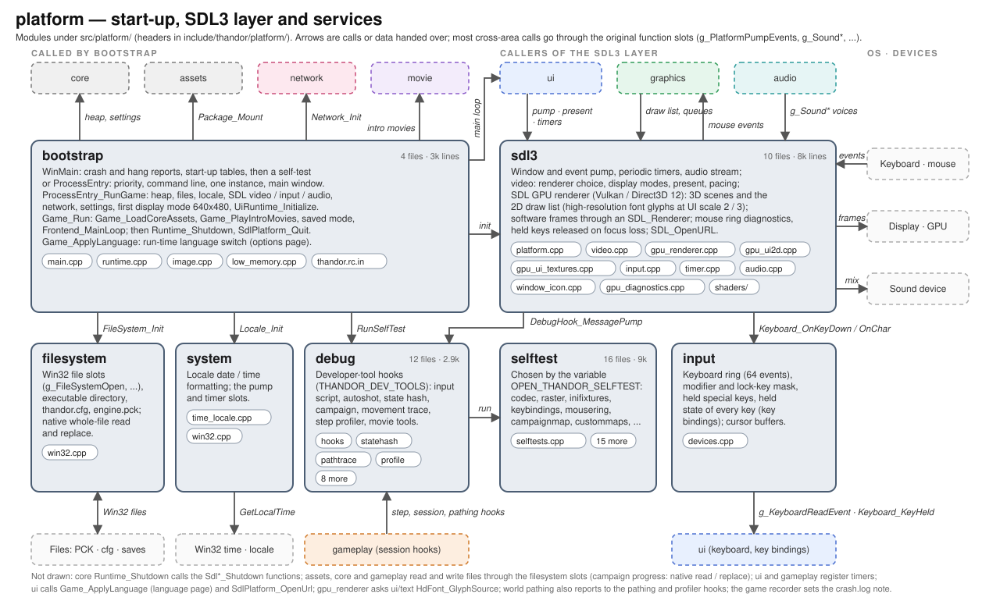

# platform

[Architecture overview](../README.md)

The platform area starts the process and connects the game to the operating system. `bootstrap` runs the start-up from `WinMain` to the front-end main loop. `sdl3` replaces the original Win32 window, DirectDraw, DirectInput, WinMM timers and DirectSound with SDL3, including the SDL GPU renderer (Vulkan or Direct3D 12). The smaller modules hold the keyboard state (`input`), Win32 file access (`filesystem`), locale and the pump and timer slots (`system`), developer tools (`debug`) and the self-tests (`selftest`). Most other areas reach platform through the original game's function slots (`g_PlatformPumpEvents`, `g_TimerRegisterPeriodic`, `g_GraphicsFramebufferPresent`, `g_Sound*`, `g_FileSystemOpen`, ...), which platform fills at start-up.

The boxes are clickable when you open [platform.svg](platform.svg) on its own: modules open their source folder, dashed area boxes open that area's page.

## Modules

| Module | Responsibility | Key files | Public headers |
| --- | --- | --- | --- |
| `bootstrap` | Program start (`WinMain`, `ProcessEntry`), subsystem start-up order, core asset loading, intro movies, command line, log, crash and hang reports, low-memory pools for the large-address-aware build | [main.cpp](../../../src/platform/bootstrap/main.cpp), [runtime.cpp](../../../src/platform/bootstrap/runtime.cpp), [image.cpp](../../../src/platform/bootstrap/image.cpp), [low_memory.cpp](../../../src/platform/bootstrap/low_memory.cpp) | `bootstrap.h`, `bootstrap/runtime.h`, `bootstrap/image.h`, `bootstrap/low_memory.h`, `bootstrap/types.h` |
| `sdl3` | Main window and event pump, periodic timers, audio stream and mixer, display modes and renderer choice, present, SDL GPU renderer (3D primitive queues and the 2D draw list), UI texture atlas, window icon | [platform.cpp](../../../src/platform/sdl3/platform.cpp), [video.cpp](../../../src/platform/sdl3/video.cpp), [gpu_renderer.cpp](../../../src/platform/sdl3/gpu_renderer.cpp), [gpu_ui2d.cpp](../../../src/platform/sdl3/gpu_ui2d.cpp), [gpu_ui_textures.cpp](../../../src/platform/sdl3/gpu_ui_textures.cpp), [input.cpp](../../../src/platform/sdl3/input.cpp), [timer.cpp](../../../src/platform/sdl3/timer.cpp), [audio.cpp](../../../src/platform/sdl3/audio.cpp), [window_icon.cpp](../../../src/platform/sdl3/window_icon.cpp), [gpu_diagnostics.cpp](../../../src/platform/sdl3/gpu_diagnostics.cpp), [shaders/](../../../src/platform/sdl3/shaders/) | `sdl3/platform.h`, `sdl3/sdl_objects.h` (backend-internal), `sdl3/types.h`, `sdl3/window_icon.h` |
| `input` | Keyboard event ring, modifier and lock-key mask, held special keys; cursor asset loading and cursor buffers | [devices.cpp](../../../src/platform/input/devices.cpp) | `input.h`, `input/devices.h`, `input/types.h` |
| `filesystem` | Win32 implementations of the file slots, executable directory, `thandor.cfg`, low-priority mount of `engine.pck`, whole-file load and write helpers | [win32.cpp](../../../src/platform/filesystem/win32.cpp) | `filesystem.h`, `filesystem/win32.h`, `filesystem/types.h` |
| `system` | Locale date and time formatting, computer label; holds the `g_PlatformPumpEvents` and `g_TimerRegisterPeriodic` slots and the window close counter | [time_locale.cpp](../../../src/platform/system/time_locale.cpp), [win32.cpp](../../../src/platform/system/win32.cpp) | `system.h`, `system/time_locale.h`, `system/win32.h`, `system/types.h` |
| `debug` | Developer-tool hooks (CMake option `THANDOR_DEV_TOOLS`; without it the hooks are inline no-ops): input script replay, automatic screenshots, state hash, campaign autowin, level-script log, movie test player and frame dump, debug font | [hooks.cpp](../../../src/platform/debug/hooks.cpp), [statehash.cpp](../../../src/platform/debug/statehash.cpp), [script.cpp](../../../src/platform/debug/script.cpp), [autoshot.cpp](../../../src/platform/debug/autoshot.cpp), [campaign.cpp](../../../src/platform/debug/campaign.cpp), [movie_player.cpp](../../../src/platform/debug/movie_player.cpp) | `debug/hooks.h`, `debug/statehash.h`, `debug/script.h`, `debug/test_aids.h`, ... |
| `selftest` | Self-tests and hash tests selected by `OPEN_THANDOR_SELFTEST`; results go to `thandor.log` | [selftests.cpp](../../../src/platform/selftest/selftests.cpp), [raster_selftest.cpp](../../../src/platform/selftest/raster_selftest.cpp), [inifixtures_selftest.cpp](../../../src/platform/selftest/inifixtures_selftest.cpp), [uiatlas_selftest.cpp](../../../src/platform/selftest/uiatlas_selftest.cpp) | `selftest/selftest.h` |

Headers are under [`include/thandor/platform/`](../../../include/thandor/platform/); `win32_constants.h` there holds the Windows constants the game uses.

## Main flows

### Start-up: from WinMain to the first menu

1. `WinMain` (main.cpp) installs the crash and hang reports (`Thandor_InstallCrashHandler`), keeps the timer resolution while hidden, installs the low-memory SDL allocator in the large-address-aware build, and builds the tables the original executable carried precomputed (`FixedMath_BuildSinCosTables`, `Movie_BuildChromaLumaTable`, the graphics lighting, minimap and software renderer tables). If `DebugHook_RunSelfTest` ran a self-test, the process ends here; otherwise it calls `ProcessEntry`.
2. `ProcessEntry` (runtime.cpp) sets high priority, runs `CommandLine_Parse`, refuses a second instance (`FindWindowA` on the window title, unless `DebugHook_AllowSecondInstance`), creates the hidden 640x480 SDL window (`SdlPlatform_CreateMainWindow`), runs `ProcessEntry_RunGame`, then `SdlPlatform_Quit` and `ExitProcess`.
3. `ProcessEntry_RunGame` starts the subsystems in the original order: `ArenaHeap_Init`, `FileSystem_Init`, `Locale_Init`, `ErrorSystem_Init`, `DynAPI_Bootstrap` (KERNEL32 and ADVAPI32 procedures), `SdlPlatform_InstallTimersAndPump`, `SdlVideo_Init`, `SdlInput_Init`, `SdlAudio_Init` (failure only fatal with `-SOUND`), `Network_Init`, `PersistentSettings_Load`. It then sets the first display mode, 640x480 on the saved renderer (`SdlVideo_SavedAdapterIndex`, `g_GraphicsSetDisplayMode`), calls `UiRuntime_Initialize` and `Game_Run`, and finally `Runtime_Shutdown`.
4. `Game_Run` sets cursor frame 0, runs `GameRuntime_InitializeSpatialAudioAndRendering` (spatial sound pool, terrain and intensity tables, the software renderer's display-mode hook, the primitive queue), then `Game_LoadCoreAssets`: the CD path from the registry, the local `flm` folder, `CoreAssets_MountPackages` (`patchNN.pck`, `levelNN.pck`, then `daten`, `modelle`, `graphik`, `sound`, `filme`, `level`), button sounds, text pages, AI workspace, `gfx\panel\stat.gfx` and the runtime buffers.
5. `Game_PlayIntroMovies` clears the screen and, unless `-NOINTRO` is given, plays `flm\intro0.flm`, `intro1.flm`, ... still in 640x480: `Movie_Open`, a periodic timer (`IntroMovie_TimerTick`) and a loop of `IntroMovie_PollSkipRequest` (pump, key or mouse-button release) and `IntroMovie_PresentPendingFrames` (`Movie_AdvanceFrame`, blit centred, `g_GraphicsFramebufferPresent`). Escape skips all remaining intros.
6. `Game_Run` reloads the settings, switches to the saved display mode (`PERSISTENT_SETTING_DISPLAY_WIDTH` / `_HEIGHT`, renderer from `SdlVideo_SavedAdapterIndex`), saves the renderer actually running (`SdlVideo_SaveAdapterIndex`) and enters `Frontend_MainLoop` in [ui](../ui/README.md). When that returns, the network backend is closed.

### Main loop and event pump

The frame loop itself lives in ui (`UiFrame_ProcessAndPresent` and `UiFrame_Update` in `ui/core/frame_loop.cpp`). Per frame it dispatches pending keyboard and pointer events, calls `g_PlatformPumpEvents` (= `SdlPlatform_PumpEvents`), runs the frame ticks counted by the periodic timers, draws and calls `g_GraphicsFramebufferPresent` (= `SdlVideo_Present`). The timers are `SdlTimer_RegisterPeriodic` (32 slots on SDL's timer thread, period 1000 / Hz ms without drift). `SdlPlatform_PumpEvents` first runs `DebugHook_MessagePump` (input script, autoshot), then handles every SDL event; a quit or close request counts `g_WindowDestroyDepth` and ends the game through `Runtime_ShutdownAndExit`. Focus changes switch the process priority and reset the lock-key bits.

### From SDL events to input state

- Keys: `HandleKeyDown` / `HandleKeyUp` (sdl3/input.cpp) map the SDL key to the Windows virtual-key code and call `Keyboard_OnKeyDown` / `Keyboard_OnKeyUp` (input/devices.cpp). Key-down sets modifier and lock bits in `g_KeyboardStateMask` or queues a key code with the modifier state in the 64-entry keyboard ring and marks held special keys in `g_KeyboardSpecialKeyDown`. Text goes through `HandleTextInput` to `Keyboard_OnChar` as Windows-1252 characters.
- Mouse: `HandleMouseEvent` updates `g_MouseButtonMask` and appends position, buttons and wheel to the `g_CursorInputEvents` ring, which belongs to [graphics](../graphics/README.md) (`graphics/core/cursor.cpp`). Fullscreen uses SDL's relative mouse mode, a window the absolute position mapped into framebuffer pixels.
- Consumers: ui reads the keyboard ring through `g_KeyboardReadEvent` (`Keyboard_ReadNextEvent`) and the pointer events through `g_GraphicsCursorConsumeEvent` (`ui/controls/input.cpp`); the in-game root frame (`ui/ingame/root_frame.cpp`) polls `g_KeyboardSpecialKeyDown` for the held navigation keys.

### Presenting a frame

- Display mode switch: `g_GraphicsSetDisplayMode` is a chain of hooks. `SdlVideo_Init` lists the renderers as adapters ("Vulkan (GPU)", "DirectX 12 (GPU)", "Software (CPU)") and installs `SdlVideo_ApplyDisplayMode` in front of the software renderer's base step; `SdlInput_Init` puts `SdlInput_SetDisplayMode` (cursor buffers) in front of that, and graphics adds `SoftwareRenderer_SetDisplayMode` later. `SdlVideo_ApplyDisplayMode` starts the chosen renderer (`StartGpuDevice`, falling back Vulkan to Direct3D 12 to software), applies window, borderless or fullscreen, and sets up the XRGB8888 framebuffer at the logical UI size (display mode divided by the UI scale).
- GPU renderer: `StartGpuDevice` replaces `g_GraphicsDrawPrimitiveQueue` with `GpuRenderer_DrawPrimitiveQueue`, so the 3D scenes that graphics has lit, projected and sorted on the CPU are drawn on the GPU. The 2D draw list of graphics (`graphics/core/draw2d.h`) records the UI; `RecordSpriteRegion` looks each sprite up in the UI texture cache (gpu_ui_textures.cpp).
- `SdlVideo_Present` counts the frame heartbeat, waits for the frame limit, and then either calls `PresentGpuFrame` (2D batches from gpu_ui2d.cpp and the waiting 3D scenes into the frame target, blitted letterboxed into the swapchain with the cursor on top), or, for the software renderer, composes the cursor into the framebuffer and presents it through an `SDL_Renderer` streaming texture. A lost GPU device is restarted (`RecoverRenderer`).

### Self-test selection

`WinMain` calls `DebugHook_RunSelfTest`, which (in a `THANDOR_DEV_TOOLS` build) passes the value of `OPEN_THANDOR_SELFTEST` to `SelfTest_Run` (selftests.cpp). `SelfTest_Run` compares the name against its list (`codec`, `path`, `pcx`, `settings`, `inifixtures`, `raster`, `hexscan`, `keymatch`, `uitemplate`, `uiatlas`, `tables`, `sam`, ...), runs the test, logs the result and returns nonzero so the process exits without `ProcessEntry`. `crash` exercises the crash handler and then starts the game.

## Interfaces to other areas

What platform calls:

- [core](../core/README.md): `ArenaHeap_Init`, `ErrorSystem_Init`, `FatalError_ExitIfFailed`, `PersistentSettings_Load` / `PersistentSettings_Read` (bootstrap, video), `Runtime_Shutdown`.
- [assets](../assets/README.md): `Package_Mount` for the core packages, `Package_MountLowPriority` for `engine.pck` (from `FileSystem_Init`), `TextResourcePage_Load` for the text pages.
- [network](../network/README.md): `Network_Init`; at the end of `Game_Run` the backend close and cleanup slots.
- [movie](../movie/README.md): `Movie_Open`, `Movie_AdvanceFrame`, `Movie_Close` for the intro movies.
- [ui](../ui/README.md): `UiRuntime_Initialize`, `Frontend_MainLoop`, `UiFrame_FlushInputAndResetPendingTicks`.
- [audio](../audio/README.md), [world](../world/README.md), [graphics](../graphics/README.md): the start-up steps of `GameRuntime_InitializeSpatialAudioAndRendering`; graphics' draw list, cursor ring and texture blits from sdl3.
- [gameplay](../gameplay/README.md): `AiRuntime_InitWorkspace` and `LevelPackage_ValidateAndMount` in `Game_LoadCoreAssets`.

Who calls platform:

- ui: the pump, present and timer slots every frame, the keyboard ring, `SdlVideo_*` getters and setters on the settings pages.
- graphics: owns the slots platform fills (`g_GraphicsSetDisplayMode`, `g_GraphicsFramebufferPresent`, `g_GraphicsFramebufferCaptureRegion`, `g_GraphicsDrawPrimitiveQueue`) and the draw list that `PresentGpuFrame` reads. The capture slot (`SdlVideo_CaptureRegion32Bit`) is used by `Screenshot_SaveFramebufferAsPcx` (bootstrap) and the autoshot tool.
- audio: the `g_Sound*` slots (`SdlAudio_CreateSampleVoiceSet`, `SdlAudio_PlayOneShot`, ...) from the spatial sound runtime.
- gameplay: timers, presents during loading, and the `DebugHook_Session*` / `DebugHook_SimulationStep*` hooks (state hash, autowin).
- assets, core, gameplay, movie: the file slots (`g_FileSystemOpen`, `g_FileSystemReadExact`, ...) and `FileSystem_WriteBufferToPath` (`thandor.ini`, saves).
- core: `Runtime_Shutdown` calls `SdlInput_Shutdown`, `SdlVideo_Shutdown`, `SdlAudio_Shutdown`, `SdlTimer_Shutdown`, `DynDLL_UnloadAll` and `Win32FileSystem_RestoreInitialDirectory`.

## Notes

- The game always runs in 32-bit colour; a requested 16-bit mode is ignored by `SdlVideo_ApplyDisplayMode`. The original only switched away from 640x480 when the saved mode differed; now the saved mode is always set.
- The original used `REALTIME_PRIORITY_CLASS`; open-thandor uses `HIGH_PRIORITY_CLASS` so a busy loop cannot starve the system's input and audio threads.
- Alt+F4 does not close the game (`SDL_HINT_WINDOWS_CLOSE_ON_ALT_F4` off), as the original window procedure swallowed `WM_SYSKEYDOWN`.
- A missing WinSock is never fatal: the original `Network_Init` reports success on every path. Without a sound device the game runs silent unless `-SOUND` is given.
- Keyboard quirk kept from the original: Escape, Enter, Tab, Backspace, Print and Pause set their held-key entry on key-down but are never released by `Keyboard_OnKeyUp`.
- Environment switches: `OPEN_THANDOR_GPU` / `-GPU` / `-SOFTWARE` force a renderer, `OPEN_THANDOR_VSYNC`, `OPEN_THANDOR_FRAME_LIMIT` and `OPEN_THANDOR_UI_SCALE` override the `[graphics]` settings; the developer tools add `OPEN_THANDOR_WINDOWED`, `OPEN_THANDOR_SCRIPT`, `OPEN_THANDOR_AUTOSHOT` and others (see `debug/hooks.h`).

## Updating the diagram

Run `python tools/docs/architecture/gen_platform.py` from the repository root; it writes [platform.svg](platform.svg). An optional argument renders a check PNG to that path.
