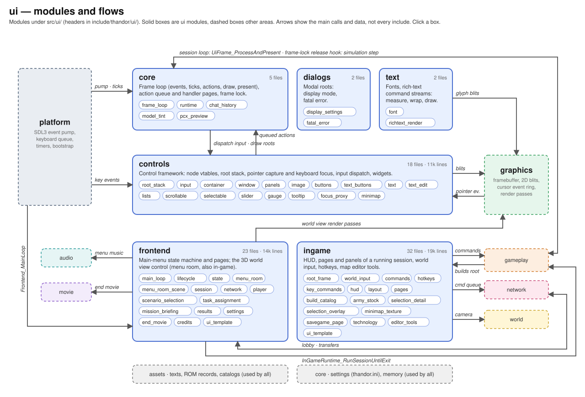

# ui

[Architecture overview](../README.md)

The ui area holds everything the player sees and clicks outside the 3D scene itself: the main-menu state machine and its pages (`frontend`), the HUD, panels and world input of a running session (`ingame`), modal dialogs, and the control framework they are all built from (`controls`, `text`). Its `core` module runs the UI frame (dispatch input, run frame ticks, run queued actions, draw, present). The same frame function is called by the menu loop, by the in-game session loop in `gameplay`, and by modal loops such as the fatal-error dialog. Releasing the UI frame lock is also what triggers the simulation step during a session.

The boxes are clickable when you open [ui.svg](ui.svg) on its own. In this page, use the table below.

## Modules

| Module | Responsibility | Key files | Public headers |
| --- | --- | --- | --- |
| [core](../../../src/ui/core/) | UI frame loop, the 20 Hz frame-tick counter, the action queue and its handler pages, the frame lock and post-unlock hook, dirty rectangles, the network receive ring; small helpers (chat history, model state tint, PCX preview) | [frame_loop.cpp](../../../src/ui/core/frame_loop.cpp), [runtime.cpp](../../../src/ui/core/runtime.cpp), [chat_history.cpp](../../../src/ui/core/chat_history.cpp) | `include/thandor/ui/core/` (`frame_loop.h`, `runtime.h`, `key_dispatch.h`, ...) |
| [controls](../../../src/ui/controls/) | Control framework: node vtables, the root stack, pointer capture, keyboard focus, keyboard and pointer dispatch, and the widgets (windows, panels, images, buttons, lists, scroll views, text edits, sliders, gauges, tooltip) | [input.cpp](../../../src/ui/controls/input.cpp), [root_stack.cpp](../../../src/ui/controls/root_stack.cpp), [container.cpp](../../../src/ui/controls/container.cpp), [window.cpp](../../../src/ui/controls/window.cpp), [scrollable.cpp](../../../src/ui/controls/scrollable.cpp), [lists.cpp](../../../src/ui/controls/lists.cpp) | `include/thandor/ui/controls/` (`types.h`, `root_stack.h`, `input.h`, ...) |
| [text](../../../src/ui/text/) | The two fonts (`engine\font.gfx`, `engine\fontk.gfx`) and rich-text command streams: measure, wrap, draw glyphs | [font.cpp](../../../src/ui/text/font.cpp), [richtext_render.cpp](../../../src/ui/text/richtext_render.cpp) | `include/thandor/ui/text/` |
| [dialogs](../../../src/ui/dialogs/) | Modal root dialogs: display mode selection with the confirm countdown, and the fatal-error box that `FatalError_ReportIfFailed` uses once the UI is up | [display_settings.cpp](../../../src/ui/dialogs/display_settings.cpp), [fatal_error.cpp](../../../src/ui/dialogs/fatal_error.cpp) | `include/thandor/ui/dialogs/` |
| [frontend](../../../src/ui/frontend/) | Main-menu state machine (`Frontend_MainLoop`), building and tearing down the menu, the menu-room scene and ROM transitions, pages (network setup, players, scenario selection, task assignment, briefing, results, settings, credits, end movie), the lobby side of the network session, and the 3D world view control used by both the menu room and the in-game world view | [main_loop.cpp](../../../src/ui/frontend/main_loop.cpp), [lifecycle.cpp](../../../src/ui/frontend/lifecycle.cpp), [state.cpp](../../../src/ui/frontend/state.cpp), [menu_room.cpp](../../../src/ui/frontend/menu_room.cpp), [menu_room_scene.cpp](../../../src/ui/frontend/menu_room_scene.cpp), [session.cpp](../../../src/ui/frontend/session.cpp), [network.cpp](../../../src/ui/frontend/network.cpp), [player.cpp](../../../src/ui/frontend/player.cpp), [ui_template.cpp](../../../src/ui/frontend/ui_template.cpp) | `include/thandor/ui/frontend/` (`main_loop.h`, `lifecycle.h`, `types.h`, ...) |
| [ingame](../../../src/ui/ingame/) | UI of a running session: the in-game root and its per-frame update, world pointer input and commands, hotkeys and key commands, HUD, build and army catalogs, selection panels and overlays, minimap texture, settings, save-game and technology pages, chat, map editor tools | [root_frame.cpp](../../../src/ui/ingame/root_frame.cpp), [world_input.cpp](../../../src/ui/ingame/world_input.cpp), [commands.cpp](../../../src/ui/ingame/commands.cpp), [hotkeys.cpp](../../../src/ui/ingame/hotkeys.cpp), [key_commands.cpp](../../../src/ui/ingame/key_commands.cpp), [layout.cpp](../../../src/ui/ingame/layout.cpp), [hud.cpp](../../../src/ui/ingame/hud.cpp), [editor_tools.cpp](../../../src/ui/ingame/editor_tools.cpp), [ui_template.cpp](../../../src/ui/ingame/ui_template.cpp) | `include/thandor/ui/ingame/` (`world_input.h`, `root_frame.h`, `types.h`, ...) |

The two `ui_template.cpp` files hold the control trees of the menu and of the in-game root as static template images; at run time they are copied into an allocated root and pushed onto the root stack.

## Main flows

### One UI frame

`UiFrame_ProcessAndPresent` (core/frame_loop.cpp) is the frame:

1. `UiKeyboard_DispatchPendingEvents` (controls/input.cpp) reads the key queue with `g_KeyboardReadEvent` (platform). Each key goes to `g_UiKeyboardFocusNode` through its `keyboardEvent` vtable slot. If the node passes the key on, the next focus targets in tree order get it. Keys nobody takes go to the front root's `keyboardFallback` callback, for example `InGameHotkeys_DispatchCommandByFlags`. While the pointer is captured, keys are discarded.
2. `UiPointer_DispatchPendingEvents` reads the pointer events with `g_GraphicsCursorConsumeEvent` (graphics cursor ring). Presses and motion go to the node under the pointer (`UiPointer_DispatchLeftPress` and the other dispatch functions). A release goes to the node that holds the pointer capture for that button.
3. `UiFrame_Update` calls `g_PlatformPumpEvents`. It then runs every pending frame tick counted by the 20 Hz timer (`UiRuntime_IncrementPeriodicTickCounter`, registered in `UiRuntime_Initialize`). Each tick advances the sprite-button animations, calls the front root's `frameUpdate` callback, ticks the capture and focus nodes, and counts down the tooltip.
4. `UiActionQueue_DispatchPending` runs the actions the controls queued with `UiActionQueue_Enqueue` (button clicks, list selections). The high byte of an action id picks a handler page and the low byte the handler. `Game_LoadCoreAssets` (platform) installs the in-game pages 0x10 to 0x12 and the frontend page 0x20 with `UiActionHandlers_SetPage`. The root-stack page 0 is installed in controls/window.cpp and the display-mode page in dialogs/display_settings.cpp.
5. `UiFrame_Draw` walks the root stack from the bottom to the front root. It calls each root's `drawClipped`, which draws its children through their vtables, then the version label and the tooltip. `g_GraphicsFramebufferPresent` presents the frame (set to `SdlVideo_Present` by platform).

Steps 1 to 4 each take `g_UiRuntimeFrameLock` and release it with `g_SpinLockReleaseAndInvoke`, which calls the hook installed by `UiRuntime_SetSynchronizationHooks`: `Frontend_StateTick` in the menu (network packets of the lobby), `InGameRuntime_UpdateSimulationAndNetworkTick` in a session (gameplay).

### Menu to session and back

`Game_Run` (platform/bootstrap) calls `Frontend_MainLoop` after `UiRuntime_Initialize` and setting the display mode. `Frontend_Init` copies the menu template, binds the shared resources and starts the menu music. It also installs `Frontend_StateTick` as the synchronization hook. The loop then calls `FrontendMainLoop_PresentFramesUntilPageAction` until an action handler sets `g_FrontendPendingPageAction`. `FrontendMainLoop_PerformPageAction` handles the action in one of three ways:

- It opens a page, such as network setup, gameplay settings, credits or quit confirm.
- It waits for the network peers on the scenario selection, task assignment and mission briefing pages (`FrontendMainLoop_AllPlayersHaveRoleState`).
- For a session it calls `FrontendRuntime_ShutdownAndReleaseResources`, then `FrontendMainLoop_RunSession`, which calls `InGameRuntime_RunSessionUntilExit` (gameplay/session/startup.cpp).

The session loop in gameplay calls `UiRootStack_InvalidateAll` and `UiFrame_ProcessAndPresent` once per drawn frame until one of three flags is set in `g_UiCommandRuntimeFlags`: session closed, end movie pending or local player left. For the end movie it calls `Frontend_PlaySelectedEndMovie` (frontend/end_movie.cpp). Back in the menu, `FrontendMainLoop_ContinueAfterSession` either continues a campaign in the briefing room or rebuilds the menu. The loop returns when the root stack is empty (quit).

### World input to player commands

During session start, `InGameSession_*` in gameplay/session/startup.cpp builds the in-game root, which uses `g_InGameUiRootCallbacks` with `InGameUiRoot_UpdateFrame` as its frame update. It also stores the ingame world-input functions in the world runtime's selection callbacks: `InGameWorldInput_ResolveContextActionAndCursor`, `_BeginPointerCapture`, `_UpdateDragSelectionAndCamera`, `_CommitPointerAction` and `InGameUiRuntime_DispatchCommandByCodeAndModifierFlags`. The map editor swaps these for its own functions in editor_tools.cpp. The world view node uses `g_FrontendModelPointerContextVtable` (frontend/menu_room.cpp). Its press and release handlers find the best model hit and report it to the context's button callbacks. Those callbacks are presumably the world-input functions above, through the shared layout of the world runtime (unverified).

`InGameWorldInput_CommitPointerAction` turns a click into select, add or remove, move, position or target commands, and places a pending army. Every command goes through `InGameCommand_Issue<Handler>` (network/protocol/commands.h). In a local game it calls the gameplay handler, for example `InGamePlayerSelection_ApplyMoveCommand` in gameplay/selection/commands.cpp, directly. In a network game it queues the handler's command code with `InGameCommandQueue_AppendLocalPlayerCommand`, and the batch runs in the next lockstep step. Buttons, hotkeys, catalogs, chat and the technology page in ingame use the same pattern.

### Opening a modal dialog

`FatalErrorRuntime_DispatchPendingError` (dialogs/fatal_error.cpp) shows the pattern:

1. Copy the dialog's template image into an allocated root.
2. Size the root to the wrapped text with `RichTextCommandStream_MeasureWrappedBlock`.
3. Push it with `UiRootStack_Push` and clear the pointer capture.
4. Call `UiFrame_FlushInputAndResetPendingTicks`.
5. Run `UiFrame_ProcessAndPresentWithLockTransition` until the dismiss action pops the root (`FatalErrorDialog_DismissAndPopRoot`).

`UiDisplaySettings_OpenAndPopulateModeSelection` builds the display-mode dialog the same way from `g_UiDisplaySettingsRootTemplate`. Its root callbacks refresh the mode selection every frame. `ErrorRuntime_InstallUiHandlerAndAllocateState`, called from `UiRuntime_Initialize`, switches `FatalError_ReportIfFailed` from exiting the process to this dialog.

### Drawing

Controls draw directly into the framebuffer. They call `g_GraphicsFramebufferBeginAccess`, then `g_GraphicsTextureSourceBlitSourceAlpha` and its sibling blits, then `g_GraphicsFramebufferEndAccess`. Text goes through `RichTextCommandStream_*` and `FontGlyph_Draw*`. The 3D view is the node `FrontendModelPointerContext_RenderWorldViewQueuesClipped`, used for both the menu room and the in-game `worldView`. It sets camera and projection, then renders the models and the terrain in up to four primitive-queue passes through graphics (`Graphics_SetActivePrimitiveQueue`, the terrain renderer). Then it draws the selection overlays and the child controls.

## Interfaces to other areas

**ui calls:**

- [platform](../platform/README.md): `g_PlatformPumpEvents`, `g_KeyboardReadEvent`, `g_KeyboardFlushEvents`, `g_TimerRegisterPeriodic` (20 Hz frame ticks, 125 ms transfer retransmit timer), spin locks, `g_CommandLineFindOption` (`-HOST`, `-CLIENT=`, `-KARTE=`), `SdlVideo_*` display-mode queries (dialogs, frontend display settings), `g_FileSystem*` (save-game page).
- [graphics](../graphics/README.md): framebuffer access and present, texture-source blits and logical sizes, texture and palette package loading, `g_GraphicsCursorConsumeEvent` and `g_GraphicsCursorSetFrame`, `g_GraphicsSetDisplayMode`, primitive queues and projection for the world view, the terrain composite texture (`TerrainCompositeTexture_*` from `InGameUiRoot_UpdateFrame`).
- [gameplay](../gameplay/README.md): `InGameRuntime_RunSessionUntilExit` (frontend), command handlers through `InGameCommand_Issue`, selection queries (`SelectionInfo_*`), save and load (`InGameSaveGame_*` in gameplay/session/savegame.cpp).
- [network](../network/README.md): backend slots `g_NetworkBackendSlot*` (frontend network setup), the transfer mailbox (`UiTransferMailbox_*`), the command batch exchange (`FrontendTransfer_*`), and the in-game command queue.
- [world](../world/README.md): camera motion (`WorldMotion_*`, `WorldRuntime_TranslateCameraByScreenDelta`, `WorldRuntime_CommitCameraTargetDistance`), edge scrolling (`WorldRuntime_ApplyEdgeScrollAndGetCursorFrame` lives in ingame), model picking and hierarchy queries for panels.
- [audio](../audio/README.md): `g_SoundPlayOneShot` for control click sounds (controls) and in-game effects, `g_SoundPlayLooping` and voice sets for the menu music (`FrontendMusic_StartMenuMusic`), music track choice in `InGameUiRoot_UpdateMusic`.
- [movie](../movie/README.md): `Movie_Open`, `Movie_AdvanceFrame`, `Movie_Close` for the end movie, the mission briefing and the menu state.
- [assets](../assets/README.md): `TextResource_Resolve` for all UI texts, ROM records for the menu room (`RomRecord_*`), `Package_LoadEntryWithSize`, `ScenarioCatalog_Rebuild`, `ArmyAssetRegistry_*` (catalogs, editor).
- [core](../core/README.md): `PersistentSettings_*` and `PersistentOption_*` (settings pages, `PersistentSettings_Flush` before and after a session), `g_MemoryApi`, `FatalError_*`.

**Who calls ui:**

- [platform](../platform/README.md): `UiRuntime_Initialize` (`ProcessEntry_RunGame`), `Frontend_MainLoop` (`Game_Run`, both in bootstrap/runtime.cpp), `UiActionHandlers_SetPage` (`Game_LoadCoreAssets`).
- [gameplay](../gameplay/README.md): the session loop and loading screens call `UiFrame_ProcessAndPresent`, `UiFrame_Update` and `UiFrame_Draw`. Session setup calls `InGameUiRuntime_InitializeControlTreeResources`, the grid rebuilds (`InGameBuildCatalog_RebuildGrid` and others), `UiRuntime_SetSynchronizationHooks` and `UiRootStack_PopUntilWindowTextureBoundary`, and stores the world-input callbacks.
- [network](../network/README.md): protocol code calls back into frontend player and session functions (for example `FrontendPlayerRuntime_IncrementReadyCountAndResolveConsensus` as an in-game command handler).

## Notes

- **Simulation runs inside the frame lock release.** `InGameRuntime_UpdateSimulationAndNetworkTick` is not called at a fixed place in the frame. It runs every time the UI releases `g_UiRuntimeFrameLock`, and paces itself by its own timer and tick counters (see gameplay/session/tick.cpp).
- **Original quirk kept:** a captured middle-button release steps the primary random stream (`Random_NextPrimary` in `UiPointer_DispatchPendingEvents`). The network simulation uses the secondary stream, so only local effects differ.
- **Fixes against the original** are marked in the code: the action queue skips ids without an installed handler instead of jumping to address 0. The end-movie path clears the pointer capture before the world grids are released. The version label is drawn by open-thandor and is not in the original.
- There are no `OtFeature` switches in `src/ui`.
