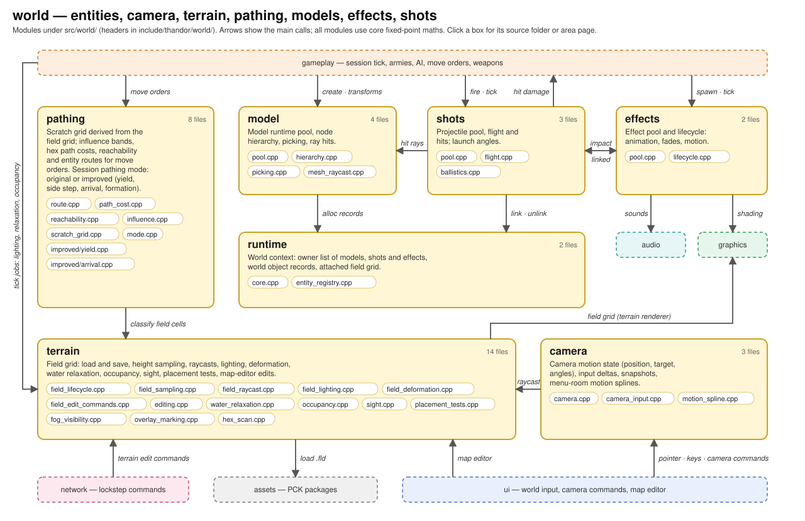

# world

[Architecture overview](../README.md)

The world area holds what exists on the map during a session: the field grid (terrain heights, water, materials, lighting, occupancy), the 3D model instances of units and buildings, shots and effects, the camera, and the scratch grid that pathfinding plans on. It has no loop of its own. [gameplay](../gameplay/README.md) drives it from the simulation tick and from army code (move orders, weapons, damage), and [ui](../ui/README.md) moves the camera and runs the map editor. All positions and angles are fixed-point values from core (`Q12`, `AngleTurn32`).

The boxes are clickable when you open [world.svg](world.svg) on its own. In this page, use the table below.

## Modules

| Module | Responsibility | Key files | Public headers |
| --- | --- | --- | --- |
| runtime | `WorldRuntimeContext`: the owner list that links every model, shot and effect node, the world object record array, the attached field grid, world flags | [core.cpp](../../../src/world/runtime/core.cpp), [entity_registry.cpp](../../../src/world/runtime/entity_registry.cpp) | [runtime.h](../../../include/thandor/world/runtime.h), [runtime/](../../../include/thandor/world/runtime/) (`core.h`, `entity_registry.h`, `flags.h`, `types.h`) |
| camera | Camera motion state (position, target, heading, pitch, distance), input deltas with clamping, motion snapshots, cubic motion splines for the menu-room scenes | [camera.cpp](../../../src/world/camera/camera.cpp), [camera_input.cpp](../../../src/world/camera/camera_input.cpp), [motion_spline.cpp](../../../src/world/camera/motion_spline.cpp) | [camera.h](../../../include/thandor/world/camera.h), [camera/](../../../include/thandor/world/camera/) |
| terrain | The field grid: load, validate and save (`.fld`), height, water and normal sampling, terrain raycasts, directional lighting, height deformation, water relaxation, occupancy masks, sight (projected occlusion), placement tests, map-editor edits | [field_lifecycle.cpp](../../../src/world/terrain/field_lifecycle.cpp), [field_sampling.cpp](../../../src/world/terrain/field_sampling.cpp), [field_raycast.cpp](../../../src/world/terrain/field_raycast.cpp), [field_lighting.cpp](../../../src/world/terrain/field_lighting.cpp), [field_deformation.cpp](../../../src/world/terrain/field_deformation.cpp), [field_edit_commands.cpp](../../../src/world/terrain/field_edit_commands.cpp), [editing.cpp](../../../src/world/terrain/editing.cpp), [water_relaxation.cpp](../../../src/world/terrain/water_relaxation.cpp), [occupancy.cpp](../../../src/world/terrain/occupancy.cpp), [sight.cpp](../../../src/world/terrain/sight.cpp), [placement_tests.cpp](../../../src/world/terrain/placement_tests.cpp) | [terrain.h](../../../include/thandor/world/terrain.h), [terrain/](../../../include/thandor/world/terrain/) |
| pathing | Scratch grid classified from the field grid and the placed models, influence distance bands around entities, hex path costs, reachability regions, entity routes for move orders. Not in the original: the session pathing mode (original or improved) and the improved mode's per-unit state, yielding to friendly blockers with side steps, arrival tests and formation slots | [route.cpp](../../../src/world/pathing/route.cpp), [path_cost.cpp](../../../src/world/pathing/path_cost.cpp), [reachability.cpp](../../../src/world/pathing/reachability.cpp), [influence.cpp](../../../src/world/pathing/influence.cpp), [scratch_grid.cpp](../../../src/world/pathing/scratch_grid.cpp), [mode.cpp](../../../src/world/pathing/mode.cpp), [improved/yield.cpp](../../../src/world/pathing/improved/yield.cpp), [improved/arrival.cpp](../../../src/world/pathing/improved/arrival.cpp) | [pathing.h](../../../include/thandor/world/pathing.h), [pathing/](../../../include/thandor/world/pathing/) |
| model | Model runtime pool (create, destroy, save/load rebase), node hierarchy (transforms, bounds, tint, billboards), pointer picking and mesh ray hits | [pool.cpp](../../../src/world/model/pool.cpp), [hierarchy.cpp](../../../src/world/model/hierarchy.cpp), [picking.cpp](../../../src/world/model/picking.cpp), [mesh_raycast.cpp](../../../src/world/model/mesh_raycast.cpp) | [model.h](../../../include/thandor/world/model.h), [model/](../../../include/thandor/world/model/) |
| shots | Shot pool and graphics resources, projectile and beam flight, hit rays against models and terrain, impact effects, launch angles and lead (ballistics) | [pool.cpp](../../../src/world/shots/pool.cpp), [flight.cpp](../../../src/world/shots/flight.cpp), [ballistics.cpp](../../../src/world/shots/ballistics.cpp) | [shots.h](../../../include/thandor/world/shots.h), [shots/](../../../include/thandor/world/shots/) |
| effects | Effect pool and graphics resources, per-tick lifecycle: animation frames, alpha fade and tint, linear or terrain-relative motion, linked and periodic follow-up effects or shots, completion actions | [pool.cpp](../../../src/world/effects/pool.cpp), [lifecycle.cpp](../../../src/world/effects/lifecycle.cpp) | [effects.h](../../../include/thandor/world/effects.h), [effects/](../../../include/thandor/world/effects/) |

## Main flows

**Entities in a simulation step.** `InGameRuntime_UpdateSimulationAndNetworkTick` (gameplay, `src/gameplay/session/tick.cpp`) runs `InGameTick_RunSimulationStep`. That function walks `worldRuntime->ownerListHead` and calls `g_RuntimeMaintenanceCallbackPhases.primaryUpdate[ownerClassId]` for every node. The table (`src/gameplay/army/class_dispatch.cpp`) points to `ArmyRuntimeMaintenance_UpdateHierarchyAiAndTimers` for models, `ShotModelRuntimeMaintenance_UpdateProjectileMotionCollisionAndEffects` for shots and `EffectModelRuntimeMaintenance_UpdateLifecycleTintScaleAndTransitions` for effects. Then `InGameTick_RunWorldJob` runs one of eight jobs, chosen by `simulationTick & 7`, so each runs every 8th step:
- `WorldLightingRuntime_UpdateInterpolatedTerrainLighting`
- `TerrainGrid_RelaxNeighborHeightsForwardWithSignGate` / `...ReverseWithSignGate`
- `FieldGrid_ApplyByteClampLookupToCells`
- `GridInfluence_ClearDistanceBandsAndRefreshEntities`
- the occupancy rebuild: `FieldGrid_ClearOccupancyMaskBits0To6AllCells`, then the `occupancyRebuild` callbacks of every node, then `GridScratch_PropagateFieldOccupancyMaskNeighborhood`

**A move order finds a route.** Army move starts in `src/gameplay/army/move_orders.cpp` (`ArmyRuntime_StartRoutedMoveCommand`, `ArmyRuntime_StartDirectMoveCommand` and others) call `EntityPathing_ResolveDestinationAndRebuildRoutes`. That function:
1. lifts the entity's own influence through the class table `g_ArmyRuntimeOrderHandlerMatrix11Columns24Classes.gridInfluenceRemove`;
2. moves a blocked start cell to the nearest open one (`GridPathCost_RelocateFromBlockedCell`);
3. tests the straight line (`GridPathLine_TestHexSegmentBlocked`);
4. when the line is blocked, propagates costs from the target (`GridPathCost_PropagateWeightedHexNeighbors`) and backtracks to the farthest cell it can reach directly (`GridPathCost_BacktrackBestHexRoute`). If the start is cut off, it first retargets with `GridReachability_RebuildConnectedRegionAroundWorldPoint` and `GridPathRegion_MarkUnreachableFromCell`.

`EntityPathing_RebuildOverlappingGroupRoutes` then heap-sorts the overlapping entities by priority. For each one, `EntityPathing_UpdateRouteSegment` stamps its planned segment into the copied scratch grid and hands changed targets back to gameplay with `ArmyRuntime_SetPendingMoveTarget`. The scratch grid itself is built from the field grid by `GridScratch_RebuildTerrainAndRuntimeClassificationMasks` (`GridScratch_ClassifyFieldCell`, `GridScratch_FloodFillFromPlacedRuntimeModels`) at session start and in the reduced update.

**Pathing modes (not in the original).** `g_PathingMode` (`include/thandor/world/pathing/mode.h`) is fixed before a session's world is built and never changes during it. With `PATHING_MODE_ORIGINAL` every pathing and movement path stays bit-exact with the original game; the improved code sits behind `Pathing_Improved()` branches and draws no extra random numbers.
- Choosing the mode: `PathingMode_ApplyForNewSession` (called from gameplay's `new_session.cpp`) takes `PathingMode_EffectiveSetting()` for a local session: the `thandor.ini` setting, but original while the "Original Thandor" switch disables `OT_FEATURE_IMPROVED_PATHING` (core). A network session uses `g_PathingNetworkImprovedAgreed`, which the lobby negotiation in `network/protocol/lobby.cpp` sets. A loaded savegame sets its stored mode with `PathingMode_SetLoaded` (`loaded_session.cpp`).
- Improved mode in the route code: `EntityPathing_*` in `route.cpp` brackets a re-plan with `PathingYield_BeginReplan` / `PathingYield_EndReplan` (the blocker becomes an obstacle), records group plans (`PathingYield_NoteGroupPlan`) and issues corridor side steps (`PathingYield_FindCorridorSideStep`, `PathingYield_IssueSideStep`).
- Improved mode called from gameplay: ground driving (`army/drive_ground.cpp`) asks `PathingYield_FindBlockingRuntime`, `PathingYield_HandleBlocked` and `PathingYield_HandleFree`; move orders (`army/move_orders.cpp`) end a move early with `PathingArrival_TestArrived` / `PathingArrival_Finish`; selection commands (`selection/commands.cpp`) spread a group over `PathingFormation_AssignPointSlots`.
- The per-unit state `g_PathingUnitState` is simulation state: savegames store it and the replay state hash includes it while the improved mode is on.
- Route planning and cost propagation report to the developer tools through `DebugHook_ProfileScope` and `DebugHook_PathingEvent` (platform `debug/profile.cpp`, `debug/pathtrace.cpp`).

**A shot flies and hits.** Gameplay fires in `ArmyRuntime_ResolveShotLaunchFromModelAttachment` (`src/gameplay/army/weapons.cpp`). It calls `ShotRuntimePool_CreateProjectileFromDefinition`, which looks up the definition (`ShotDefinitionRegistry_LookupById` in assets), computes launch angles (`ShotDefinition_ComputeLaunchAngles`), allocates a world object record and links the node into the owner list. Each tick, `ShotModelRuntimeMaintenance_UpdateProjectileMotionCollisionAndEffects`:
1. updates the trajectory (`ShotProjectile_UpdateBallisticTrajectory`, `...LeadAdjustedTrajectory`, `...FixedRangeTrajectory` or `ShotProjectile_SteerTowardsTarget`) and calls `ShotProjectile_MoveOneStep`;
2. casts hit rays with `ShotModel_CastHitRays`, which uses `ModelRuntime_RaycastCandidateListNearest` against models and `FieldGrid_RaycastTerrainSurfaceDistance` / `FieldGrid_RaycastSecondarySurfaceDistance` against the terrain;
3. resolves the hit in `ShotProjectile_ApplyNearestHit`. An army hit goes to `ShotProjectile_ImpactArmy`, which calls gameplay's `ArmyRuntime_ApplyImpactDamageToRuntimeAndParent` and `ShotRuntime_ApplyArmyHitRelationAndNotifications`. A terrain hit goes to `ShotModel_EmitTerrainImpactEffect`.

Beams use the same path through `ShotBeam_UpdateTick` and `ShotBeam_ApplyArmyHit`. All impact and trail effects go through `ShotModel_EmitEffectAlongHeading` to `EffectRuntimePool_CreateInstanceFromDefinition`.

**An effect lives and ends.** `EffectRuntimePool_CreateInstanceFromDefinition` allocates the record, links it into the owner list, gets a shading record (`GraphicsShadingRuntime_AllocateRecord`) and can play a positioned one-shot sound (`SpatialSound_PlayPositionedOneShot`). Per tick, `EffectModelRuntimeMaintenance_UpdateLifecycleTintScaleAndTransitions`:
- advances frames and fades (`EffectLifecycle_AccumulateAnimationFrame`, `EffectLifecycle_UpdateAlphaFadeAndTint`);
- moves the effect: `EffectLifecycle_IntegrateLinearMotion`, or `EffectLifecycle_AdvanceTerrainRelativeMotion`, which follows `FieldGrid_InterpolateTerrainHeightAndNormal`;
- spawns follow-ups: `EffectLifecycle_CountDownLinkedEffect`, `EffectLifecycle_CountDownPeriodicEffect`, and `EffectLifecycle_CountDownLinkedShot` (to `ShotRuntimePool_CreateProjectileFromDefinition`).

At the end, `EffectLifecycle_CountDownCompletionAction` can deform the terrain (`FieldGrid_ApplyRadialTerrainHeightDeltaAndRefreshSurface`), destroy the owner's model (`ModelRuntimePool_DestroyHierarchyAndDetach`) or spawn an army (`EffectLifecycle_SpawnArmyFromOwner`, gameplay).

**The camera follows input.** In the game, `WorldRuntime_ApplyEdgeScrollAndGetCursorFrame` (`src/ui/ingame/world_input.cpp`) and the root frame call `WorldRuntime_TranslateCameraByScreenDelta`, then `WorldRuntime_RecomputeMotionEndpointAgainstFieldSurface`. That function raycasts the view ray against the terrain (`FieldGrid_RaycastTerrainSurfaceDistance`) and updates the target distance. Camera commands (`src/ui/ingame/camera_commands.cpp`) use `WorldRuntime_SetCameraPositionKeepingTarget` and `WorldRuntime_CommitCameraTargetDistance`. Jump-to-target keys use `WorldRuntime_PointCameraAtTarget`. The front-end menu room drives the same state with `WorldMotion_Adjust*` and plays scripted flights with `WorldMotionSpline_BuildSixChannelCurves` / `WorldMotionSpline_EvaluateAndApplyAtTime`. Distance and pitch limits are skipped with `WORLD_RUNTIME_FLAG_UNLIMITED_CAMERA` (`flags.h`).

## Interfaces to other areas

**Who calls world**
- [gameplay](../gameplay/README.md):
  - Session setup: `WorldRuntime_AttachFieldGridAsset`, `ModelRuntimePool_Init`, `EffectRuntime_InitGraphicsResources` / `ShotRuntime_InitGraphicsResources` in `level_new.cpp` / `level_saved.cpp`; `FieldGrid_LoadValidated` in `scenario_load.cpp`; `GridScratch_AllocateForFieldGrid` in `startup.cpp`.
  - Savegames: `ModelRuntimePool_UnrebaseBeforeSave` / `..._RebaseAfterLoad`, `ShotRuntime_RebaseSlotsAfterLoad`, `EffectRuntime_RebaseSlotsAfterLoad`.
  - Simulation tick: see Main flows.
  - Army code: models (`ModelRuntimePool_CreateInstanceByDefinitionId`, `ModelNodeRuntime_RebuildTransformsFromRoot`), terrain sampling and placement tests, influence bands, move orders, shot launch and effect spawn.
- [ui](../ui/README.md):
  - Camera input and commands.
  - Map editor terrain edits (`TerrainEditBuffer_*`, `FieldGrid_Apply*CellDeltas`, `FieldGrid_SaveAssetImageFromRuntimeState` in `InGameUiCommand_SaveFieldAndLevelAssetImages`).
  - Menu-room scenes (world object records, models, motion splines, `ModelRuntimeNode_HitTestProjectedBoundsAndChildren`).
- [network](../network/README.md): the command table in `src/network/protocol/commands.cpp` maps editor commands to terrain functions (`TerrainGrid_RunDirectionalRelaxationPasses`, `FieldGrid_ApplyEncodedCellUpdate`, `TerrainMaterialEdit_Seed*`, `TerrainEditBuffer_*`), so map edits run in lockstep.
- [graphics](../graphics/README.md):
  - The terrain renderer (`src/graphics/terrain/terrain_render.cpp`) and the shadow texture read the `FieldGridAsset` directly.
  - The render code calls `ModelNodeRuntime_BuildBillboardRotation` / `ModelNodeRuntime_BuildViewFacingRotation`, `FieldGrid_InitializeRuntimeCellsAndBoundaryFlags` and `FieldGrid_RaycastTerrainSurfaceDistance`.
- [platform](../platform/README.md): self-tests (`src/platform/selftest/`) call terrain scans and placement tests directly.
- [network](../network/README.md) (again): the lobby sets `g_PathingNetworkImprovedAgreed` and reads `PathingMode_EffectiveSetting` (`network/protocol/lobby.cpp`).
- [assets](../assets/README.md): the catalogs call `ShotRuntime_FindDefinitionById` / `EffectRuntime_FindDefinitionById` (one call each).

**What world calls**
- [gameplay](../gameplay/README.md):
  - Damage and hit relations from shots (`ArmyRuntime_ApplyImpactDamageToRuntimeAndParent`, `ShotRuntime_ApplyArmyHitRelationAndNotifications`).
  - `ArmyRuntime_SetPendingMoveTarget` from pathing; `EffectLifecycle_SpawnArmyFromOwner` from effects.
  - The per-class handler table `g_ArmyRuntimeOrderHandlerMatrix11Columns24Classes` (`gridInfluenceAdd` / `gridInfluenceRemove` from pathing, `modelClassInitialize` from the model pool).
  - `MoviePlayback_AdvanceScheduledFrameAndTick` (`src/gameplay/session/loading_movie.cpp`) between the load steps of the shot and effect graphics.
- [assets](../assets/README.md):
  - Definition lookups: `ModelDefinitionRegistry_LookupById` / `..._FindById`, `ShotDefinitionRegistry_LookupById`, `EffectDefinitionRegistry_LookupById`.
  - `Package_LoadEntryWithSize` for the field grid.
- [graphics](../graphics/README.md):
  - Shading records for shots and effects (`GraphicsShadingRuntime_AllocateRecord`).
  - Texture set and palette loading (`g_GraphicsTextureSetLoadPackage`, `g_GraphicsPaletteAssetLoadPackage`).
  - `Graphics_ProjectViewPoint` for pointer picking.
- [audio](../audio/README.md): `SpatialSound_PlayPositionedOneShot` (effects) and `SpatialSound_UpdateDesiredPositionedGains` (shots, `ShotRuntimeMaintenance_UpdateHierarchyProjectedSound`).
- [platform](../platform/README.md): `FileSystem_WriteBufferToPath` when the editor saves the field grid; `DebugHook_ProfileScope` and `DebugHook_PathingEvent` in the route code.
- [core](../core/README.md): fixed-point maths (`FixedMath_*`, `FixedTransform_*`), `Random_NextPrimary` in field grid initialisation, memory API for the pools, `OtFeature_Active(OT_FEATURE_IMPROVED_PATHING)` in `PathingMode_EffectiveSetting`.

## Notes

- Shots, effects and model nodes are records of one world object array (`WorldObjectArray_AllocateFreeRecord`). They share the owner list, and gameplay dispatches on `ownerClassId`, so the update order inside a step is the list order.
- The pools live in single arena blocks (`SHOT_RUNTIME_POOL_BYTES`, `EFFECT_RUNTIME_POOL_BYTES`, `MODEL_RUNTIME_POOL_BYTES`). Savegames store pool offsets, which the `*_RebaseAfterLoad` functions turn back into pointers.
- Several checks are marked "Not in the original" in the code:
  - The model pool validates the rebased links and nodes of a loaded savegame and clears the ones that do not land in their pool.
  - `EntityPathing_ResolveDestinationAndRebuildRoutes` returns the target unchanged when the scratch grids are already released (end of session).
  - Picking returns `nullptr` on a miss instead of a leftover scratch value.
- `EffectRuntimePool_CreateInstanceFromDefinition` keeps the original's swapped parameters: `worldYQ12` is written to `translation.x`.
- The only OtFeature test in world is `OT_FEATURE_IMPROVED_PATHING` in `pathing/mode.cpp`; it takes effect with the next session, never inside a running one.
